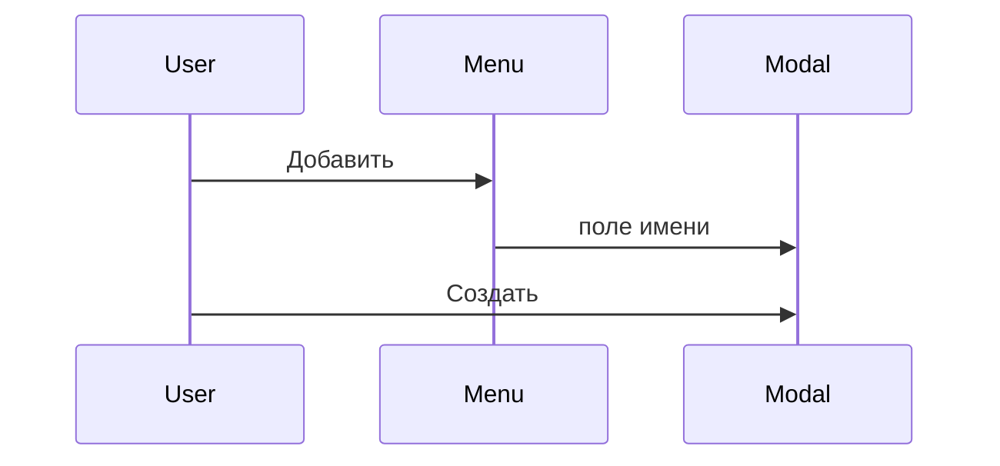

# Модалки действий

Действие, в котором нужно что-то ввести, открывает модалку. Действие без полей спрашивает подтверждение.

Ввод: имя новой фичи, исходный текст файла, строка задачи аналитика.

Подтверждение: удалить фичу, опубликовать проект, сменить статус файла, сохранить настройки в админке.

Поле имени фичи уходит из шапки. Форма строки задачи уходит из карточки документа. Текст документа на странице остаётся отрендеренным.

