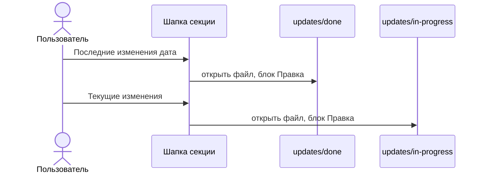

# Подписи в шапке коллапсера

Ссылка на последнее применённое изменение читается «Последние изменения 21.10.2026». Дата по-прежнему открывает файл из `updates/done` на блоке «Правка». Если применённых изменений нет, ссылки нет.

Кнопка справа:

- нет файла в `updates/in-progress` для этого `source` и `section` — «Добавить изменение», создаёт новый файл;
- такой файл есть — «Текущие изменения», открывает его на блоке «Правка» и новый файл не создаёт.

Несколько незакрытых файлов на одну секцию: открывается самый поздний по префиксу даты в имени.

