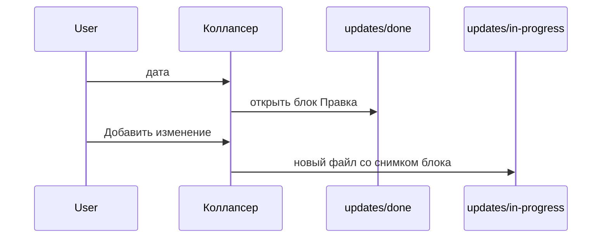

# Дата и кнопка в коллапсере

В шапке каждого коллапсера справа: дата последнего применённого изменения, если оно есть, и кнопка «Добавить изменение».

Применённое изменение — файл в `updates/done`, у которого `source` совпадает с именем текущего файла, а `section` с заголовком коллапсера. Дата берётся из имени `YYYY-MM-DD-HHMM` и показывается как `DD.MM.YYYY`. Это ссылка на файл изменения и блок «Правка» внутри него.

Кнопка создаёт новый файл в `updates/in-progress`. В нём `source`, `section`, и секции «Оригинал» и «Правка» с текущим текстом блока. Клик по кнопке и по дате не сворачивает коллапсер.

На файлах внутри `updates` этих элементов нет.

