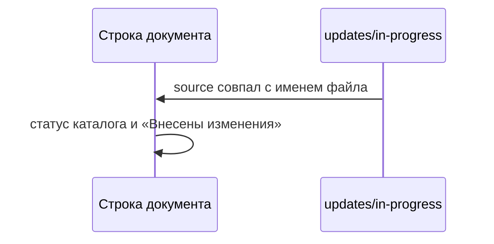

# Статус в строке документа

Рядом со статусом каталога в строке открытого файла появляется тег «Внесены изменения», если среди файлов `updates/in-progress` есть `source` с именем этого файла.

Статус каталога остаётся. У файла без незакрытого изменения второго тега нет. Внутри файла из `/updates/` тег не показывается.

