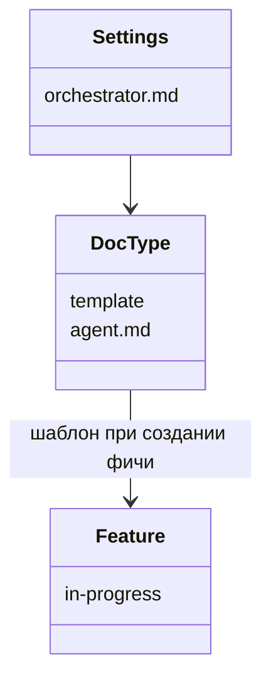

# Настройки типов документов

`docs/settings` задаёт типы документов фичи. Это не проект: селектор и дерево фич его не показывают. Отдельный маршрут `/settings` открывает тот же просмотр, что и фича: дерево слева, каталог или файл справа. Пункт «Настройки» стоит в бургер-меню шапки. На `/settings` тот же бургер возвращает к документации пунктом «Документация».

Новая фича собирает файлы в `in-progress` из шаблонов настроек, а не из зашитого списка в коде.

```text
docs/settings/
  orchestrator.md
  analyst/
    template.md
    agent.md
  designer/
    template.md
    agent.md
  backend/
    template.md
    agent.md
  tester/
    template.yaml
    agent.md
  frontend/
    template.md
    agent.md
```

Имя файла в фиче — имя каталога типа и расширение шаблона: `analyst/template.md` становится `analyst.md`, `tester/template.yaml` становится `tester.yaml`. В тексте шаблона `{{feature}}` заменяется на feature-id. Каталог без файла `template.*` в фичу не попадает. Если шаблонов нет совсем, создание фичи отвечает «Нет шаблонов в настройках» и каталог фичи не создаёт.

`agent.md` — инструкция писать документ этого типа по соседнему шаблону, без новых разделов. `orchestrator.md` по имени файла фичи (`analyst.md`, `tester.yaml` и остальные) выбирает каталог типа и отдаёт работу его `agent.md`. Визуализатор эти файлы показывает и сохраняет как обычные документы. Он не запускает агентов.

Пять каталогов выше повторяют нынешние шаблоны создания фичи. Текст шаблона совпадает с текущим генератором, подстановка feature-id записана как `{{feature}}`. Те же файлы лежат в `apps/server/test/fixtures/docs/settings/`.

Изменения в `docs/settings` видны в меню изменений и публикуются вместе с документами. Каталог `method` по-прежнему скрыт и из дерева, и из изменений.



```mermaid
sequenceDiagram
  actor User as Пользователь
  participant Burger as Бургер
  participant Settings as /settings
  participant Create as Создание фичи

  User->>Burger: Настройки
  Burger->>Settings: дерево docs/settings
  User->>Settings: открывает шаблон или agent.md
  User->>Create: новая фича
  Create->>Settings: читает template.*
  Create-->>User: in-progress по одному файлу на тип
```
