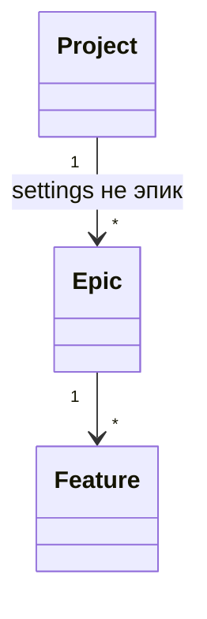
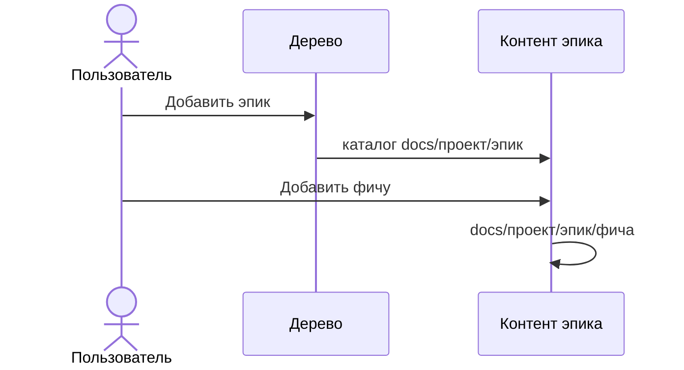

# Фичи внутри эпиков

Фича не лежит в корне проекта. Сначала создаётся эпик, затем фича внутри него. Дерево документации начинается с эпиков. Действия над фичами находятся в контенте эпика.

```text
docs/<проект>/
  settings/          не эпик и не фича, в дереве документации не показывается
  <эпик>/
    <фича>/
      in-progress/
      ready-to-implement/
      done/
      assets/
      updates/
```

Имя эпика и имя фичи — kebab-case, то же правило, что `isFeatureId`. `settings` эпиком не является.

Существующие фичи переносятся в эпик `main`:

- `docs/billing/invoices` → `docs/billing/main/invoices`
- `docs/payments/order-list` → `docs/payments/main/order-list`
- `docs/payments/payment-card` → `docs/payments/main/payment-card`

То же в `apps/server/test/fixtures/docs` и, если каталог есть, в `data/mock/docs`. `data/mock` не коммитится.

## Сервер

`describe('docs/<проект>/<эпик>')` возвращает `kind: 'epic'`, если каталог не `settings` и не фича. Фича по-прежнему узнаётся по каталогам статуса.

- `POST /api/epics` `{ project, epicId }` создаёт пустой каталог. Повтор — «Эпик уже существует». Имя не kebab-case или `settings` — «Имя эпика — kebab-case». Нет проекта — «Проект не найден».
- `POST /api/epics/rename` `{ path, epicId }` переименовывает каталог эпика внутри того же проекта. Цель занята — «Эпик уже существует». Это не эпик — «Переименовывать можно только каталог эпика».
- `DELETE /api/epics?path=` удаляет каталог эпика вместе с фичами внутри. Это не эпик — «Удалять можно только каталог эпика».
- `POST /api/features` принимает `{ project, epic, featureId }`. Эпика нет — «Эпик не найден», каталог фичи не создаётся. Фича пишется в `docs/<проект>/<эпик>/<фича>/`. Шаблоны по-прежнему из `docs/<проект>/settings`.

Переименование фичи оставляет её в том же эпике. Путь файла спеки — шесть сегментов: `docs/<проект>/<эпик>/<фича>/<статус>/<файл>`. Каталог фичи для изменений — первые четыре сегмента.

## Экран документации

Бургер: «Добавить эпик» вместо «Добавить фичу». Окно как у фичи: «Имя (kebab-case)», «Отмена», «Создать».

Контент эпика:

- шапка: имя эпика, «Переименовать», «Удалить» с подтверждением «Удалить эпик?»;
- «Добавить фичу» в этой шапке;
- у каждой фичи в списке «Редактировать» и «Удалить».

В контенте самой фичи этих кнопок нет. Статус фичи остаётся.

В шапке, на странице документации, перед полем «Фича» стоит поле «Эпик». Подстрока имени без учёта регистра. Фильтр фичи и статуса по-прежнему отбирает фичи внутри эпика. Эпик скрывается, если его имя не совпало или, при активном фильтре фичи, ни одна его фича не совпала. Пустой результат в дереве — «Ничего не найдено». На странице настроек этих фильтров нет.




