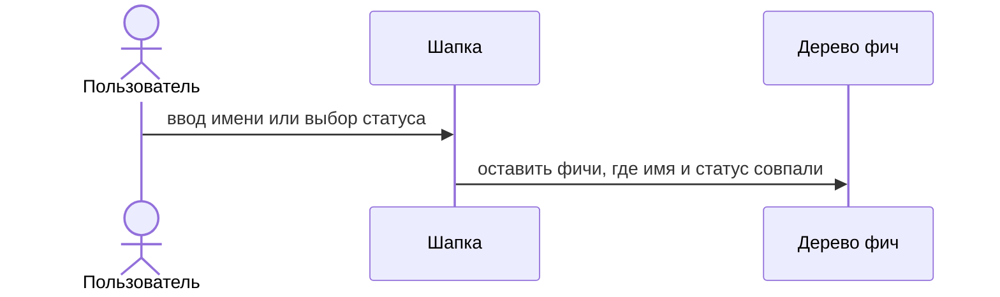

# Фильтр фич в шапке

Справа от селектора проекта два поля. Они сужают список фич выбранного проекта сразу, без кнопки.

Имя: подстрока без учёта регистра. Пустое поле не отсекает фичи.

Статус: «Все», «Требуется изменение», «В процессе», «Готово к реализации», «Выполнено». «Все» не отсекает фичи. Иначе остаётся фича с этим статусом.

Фильтр действует на строки фич в дереве и на список фич в карточке проекта. Файлы внутри открытой фичи не фильтруются. Открытый документ не закрывается, если его фича скрыта фильтром.

