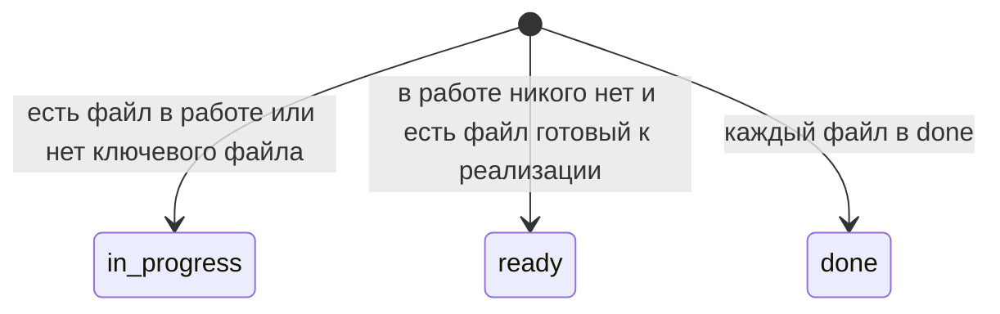

# Статус фичи по приоритету файлов

Статус фичи — один из `in_progress`, `ready`, `done`. Он считается по **всем** файлам в `in-progress`, `ready-to-implement` и `done`, не только по пяти ключевым.

Порядок такой, первое совпадение побеждает:

1. Есть хотя бы один файл в `in-progress`, или ключевой файл отсутствует — фича «В процессе».
2. Есть хотя бы один файл в `ready-to-implement` — фича «Готово к реализации».
3. Каждый файл лежит в `done` — фича «Выполнено».

Отсутствующий ключевой файл считается «в процессе». Лишние файлы (`large.md`, `обзор.md` и любые другие) участвуют в том же правиле. Каталог `assets` не входит в статус.

Один и тот же файл в нескольких каталогах берётся по наименее зрелому: `in-progress`, затем `ready-to-implement`, затем `done`.

