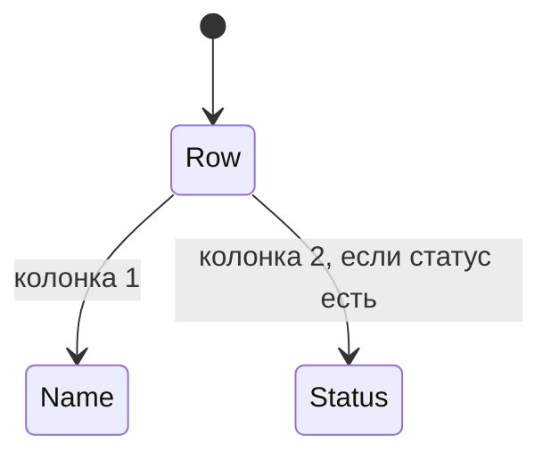

# Сетка списка файлов

Список в карточке каталога — две колонки. В первой имя файла или папки, во второй статус. Колонки общие для всех строк: кнопки одной ширины, метки начинаются с одной вертикали.

Строка без статуса занимает только первую колонку. Список не растягивается на всю карточку: ширина колонки имени — по самому длинному имени.

