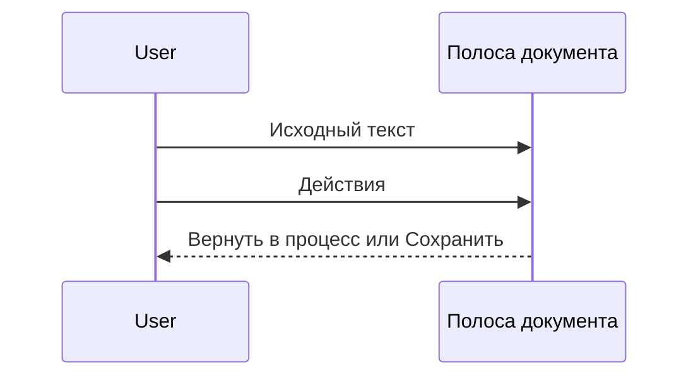

# Шапка, крошки и меню

Крошка файла и каталога не начинается с `docs`. Реальный путь запроса не меняется.

Шапка на всю ширину. Дерево — колонка под ней, слева от карточки.

В полосе документа кнопка «Исходный текст» остаётся. Смена статуса и «Сохранить» стоят справа от неё, внутри меню «Действия».

