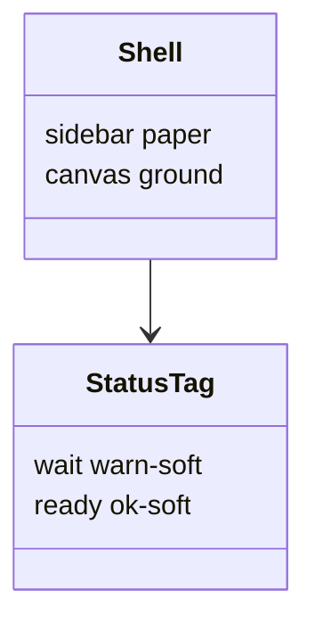

# Вид Katran

Визуализатор выглядит как оболочка демо Katran: светлый холст, белая колонка дерева, синие акценты, шрифт IBM Plex. Пакет `@katran/ui` не подключается.

## Палитра и шрифт

Светлая тема из `packages/tokens` проекта katran:

| Токен | Значение |
|-------|----------|
| ground | `#EEF1F6` |
| paper | `#FFFFFF` |
| hover | `#F2F6FA` |
| ink | `#141A29` |
| ink2 | `#3A4357` |
| muted | `#6B7488` |
| line | `#DCE1EA` |
| val | `#3A6EA5` |
| val-soft | `#E9EFF7` |
| ok | `#17844B` |
| ok-soft | `#E3F5EA` |
| bad | `#C2372E` |
| warn | `#A8620B` |
| warn-soft | `#FDF1DD` |
| sunk | `#F5F7FB` |

Шрифт: `"IBM Plex Sans"` для интерфейса, `"IBM Plex Mono"` для кода и YAML. Подключение — ссылка Google Fonts в `Document.tsx`.

## Оболочка

Как `apps/demo/src/Shell.tsx`: слева колонка на `paper` с линией справа, справа холст `ground`. Шапка светлая, на `paper`, с нижней линией. Тёмно-зелёной полосы нет.

Кнопки как ghost Katran: высота 28px, радиус 6px, рамка `line`, текст `ink2`. Основные действия («Добавить», «Опубликовать», «Сохранить») — заливка `val`, текст `paper`.

Строка дерева — не кнопка с рамкой: прозрачный фон, скругление 4px, наведение `hover`, выбранная строка — текст `val` и фон `val-soft`.

Статусы — пилюли Katran: текст `ink2`, точка 6px. «В процессе» — фон `warn-soft`, точка `warn`. «Готово к реализации» — фон `ok-soft`, точка `ok`.

