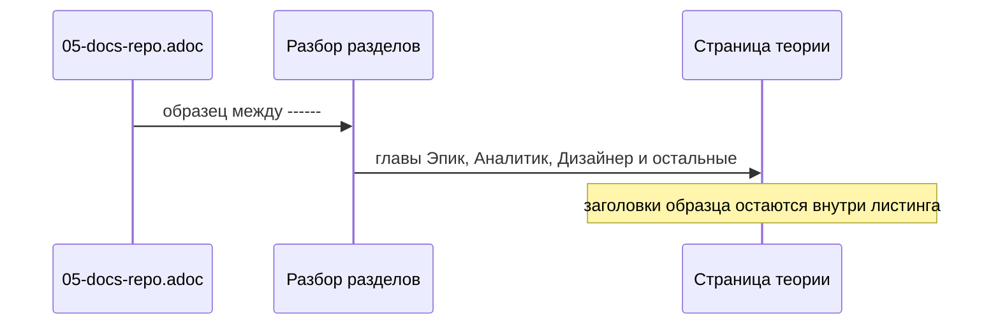

# Читаемая разметка метода

Документы `docs/method` остаются теми же главами и теми же правилами. Меняется только разметка, из-за которой текст трудно читать.

В `05-docs-repo.adoc` образец файла роли открыт блоком `[source,asciidoc]` на `----`, а внутри лежит ещё один `----` для mermaid или json. Внутренняя черта закрывает внешний блок. Хвост образца — заголовки `==` и таблицы — становится живым текстом главы.

Внешний блок образца открывается и закрывается более длинной чертой `------`. Внутренние `----` остаются. Смысл критериев, таблиц и схем не меняется.

Абзац длиннее нескольких предложений разбивается на короткие абзацы или список. Слова правил сохраняются.

Разбор разделов в просмотре узнаёт черту из четырёх и более одинаковых символов и закрывает блок только такой же чертой. Строка `==` внутри образца не становится разделом страницы.

