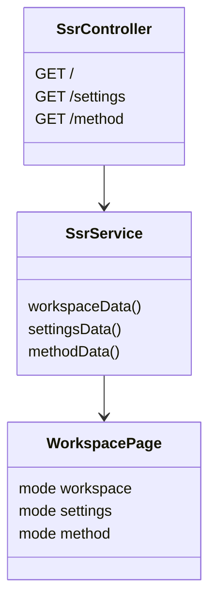
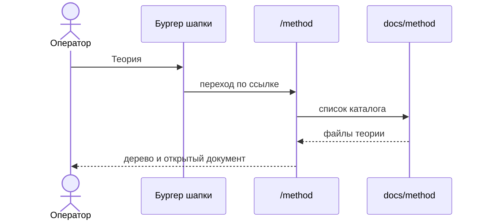

# Маршрут теории

Теория метода лежит в `docs/method` и не является проектом: селектор проектов её не показывает. Отдельный маршрут `/method` открывает это дерево в том же каркасе, что фичи и настройки. В бургере шапки на неё есть ссылка.

`method` по-прежнему не проект. Создание эпиков, фич и агентов на этом экране нет. Файлы читаются и правятся существующим просмотром документа.

