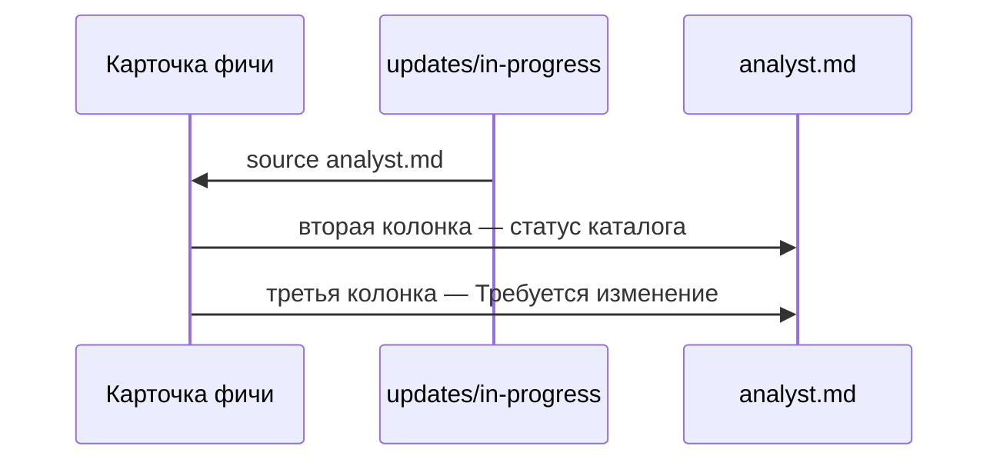

# Третья колонка «Требуется изменение»

В карточке фичи список файлов остаётся сеткой. Первая колонка — имя, вторая — статус каталога. Третья колонка есть только у файла, на который ссылается незакрытый файл в `updates/in-progress` (`source`). Подпись третьей колонки — «Требуется изменение».

Статус каталога на месте: `analyst.md` может быть «Готово к реализации» и одновременно «Требуется изменение». У файла без незакрытого изменения третья колонка пустая. Каталог `updates` её не получает.

