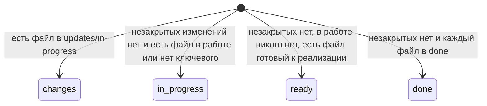
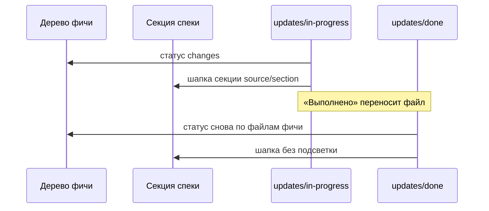

# Статус фичи при незакрытом изменении

Файл в `updates/in-progress` — нереализованное изменение. Пока такой файл есть, статус фичи — `changes`, подпись «Требуется изменение». Этот статус выше «В процессе», «Готово к реализации» и «Выполнено».

Файлы фичи не переносятся. Их теги по-прежнему берутся из `in-progress`, `ready-to-implement` и `done`. Каталог `updates/done` на статус фичи не влияет. `assets` не входит в статус.

Шапка коллапсера секции, на которую ссылается незакрытый файл (`source` и `section`), красится фоном `--bad-soft`. Дата последнего применённого изменения и кнопка «Добавить изменение» остаются.

