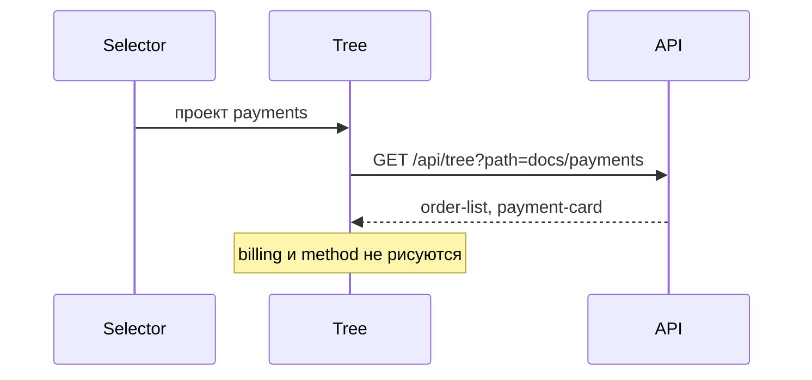

# Дерево выбранного проекта

Селектор «Проект» задаёт, какие фичи видны в дереве.

В дереве нет корня `docs`, нет имени проекта и нет других проектов. Нет каталога `method`. Верхний уровень — фичи выбранного проекта. Раскрытие фичи по-прежнему показывает её файлы, `assets` и цветные теги статуса.

Правая панель при смене проекта открывает этот проект и перечисляет те же фичи.

Первый HTML уже содержит фичи первого проекта из селектора, чтобы сервер и клиент нарисовали одно и то же дерево.

