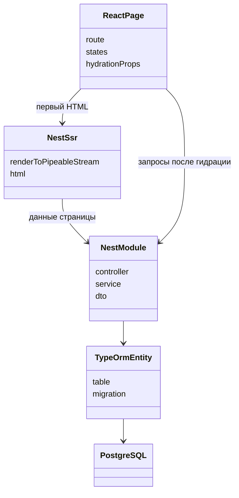
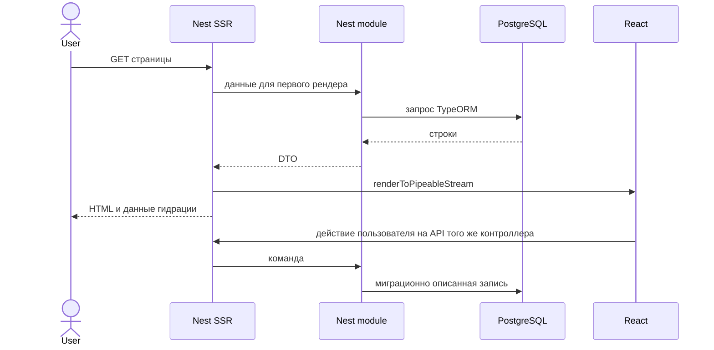

# Стек агентов: React + Nest SSR + PostgreSQL

Агенты этого репозитория больше не собирают админку OpsNext и не следуют правилам PMTS ERMO. Когда агент проектирует или реализует приложение, стек один:

- **React** — интерфейс. Компоненты объявляются как `FC<Props>`.
- **Nest SSR** — один процесс NestJS. Он отдаёт HTTP API и первый HTML страницы через серверный рендер React (`renderToPipeableStream`). Клиент только гидрирует этот HTML.
- **PostgreSQL** — единственная база. К ней ходит только Nest, через TypeORM (`@nestjs/typeorm`, драйвер `pg`). Схема меняется миграциями TypeORM. React к базе не подключается.

Репозиторий `sdd-visualizer` по-прежнему хранит метод и спецификации `features/<feature-id>/`. Код приложения агенты пишут в репозитории приложения, раскладывая его по каталогам ниже. В этом репозитории агенты не создают `src/`, страницы, Nest-модули и клиент API.

Родительские правила `Projects/.cursor/rules` описывают другой продукт (Effector, Admiral DS, Orval, Craco, Module Federation, словари Omni). Для задач этого репозитория их стек не применяется. Источник стека — этот SPEC и `.cursor/rules/00-project-context.mdc`.

## Каталоги приложения

```text
apps/web/                         React
  src/pages/<Page>/               страница и её состояния
  src/features/<feature>/         сценарий экрана: форма, действия
  src/shared/                     общие компоненты и клиент к Nest API

apps/server/                      NestJS
  src/main.ts
  src/app.module.ts
  src/ssr/                        рендер React, отдача HTML, данные гидрации
  src/<feature>/                  module, controller, service, dto
  src/database/                   TypeORM: data-source, сущности, миграции
```

Страница без своего сценария не заводит пустую фичу. Операция без таблицы не заводит сущность TypeORM.





## Что заменить в правилах и методе

Убрать как целевой стек и как эталоны: OpsNext, `pmts-omni12-core-ui`, словари, Admiral DS, `@omni/react-omni-ui`, react-query, Orval, ручной axios, Craco, Module Federation, Effector, `SystemsDictionary`, `DictionarySystemsTable`, `features/systems`, `entities/systems`, `entities/sns-condition`, `OperationActions`, `StreamingActions`, `tableConfig.number`, `@hooks`.

Контракт операции живёт в Nest: контроллер, DTO, сервис. OpenAPI, если он нужен, выпускает `@nestjs/swagger` из этих DTO. Клиент React вызывает этот контроллер. Отдельный сгенерированный Orval-клиент не является источником типов.

В `backend.md` помимо операции называются сущность TypeORM, таблица PostgreSQL и миграция. Эффект записи — изменение строк этой таблицы.

В `frontend.md` слои — страница React, фича экрана, Nest-модуль и SSR-маршрут. Эталон новой страницы — каталоги `apps/web/src/pages`, `apps/web/src/features`, `apps/server/src/<feature>`, `apps/server/src/ssr`, `apps/server/src/database`.

Проверки приложения: `npm run build` и тесты в `apps/server` и `apps/web`, применение миграций TypeORM к PostgreSQL. Команд `api-generate`, `arch:imports`, `arch:circular` в этом стеке нет.

Правила `61-react-component-signature` и `63-event-handler-pass-through` остаются: они про React и не зависят от Omni.

## Вне задачи

- Не создавать само приложение и не добавлять зависимости в этот репозиторий.
- Не менять уровни зрелости, имена ролей и состав файлов `analyst.md`, `designer.md`, `backend.md`, `tester.yaml`, `frontend.md`.
- Не вводить Prisma, Drizzle, MongoDB, GraphQL и отдельный SPA без SSR.
