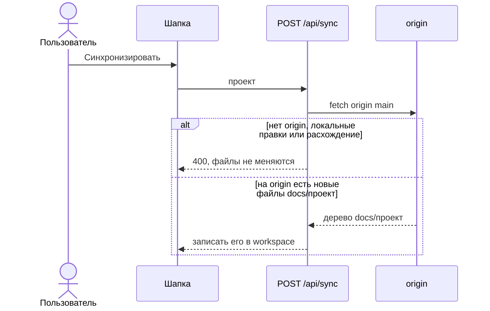

# Обновления из репозитория проекта

Админки нет. Адрес и токен проекта больше не читаются из `global/configs.yaml`.

Синхронизация и публикация ходят в `origin` того git-репозитория, где запущен визуализатор. Корень git ищется вверх от `process.cwd()` по каталогу `.git`. Документы по-прежнему читаются из корня workspace (`DOCS_ROOT` или текущий каталог).

## Правила

- Нет `origin` — «У репозитория нет origin».
- В `docs/<проект>` workspace есть незафиксированные отличия от `HEAD` — «Сначала опубликуйте локальные изменения».
- И локальные коммиты, и `origin/main` меняли `docs/<проект>` — «Изменения разошлись с репозиторием». Слияния нет.
- Вперёд ушёл только `origin` — `docs/<проект>` в workspace становится как на `origin/main`, включая удаления.
- Публикация коммитит `docs/<проект>` в этот же репозиторий и делает `git push origin HEAD`. Токен в URL не подставляется.
- Если workspace и корень git — разные каталоги, публикация переносит файлы из workspace в `docs/<проект>` корня git, затем коммит и push. Синхронизация пишет дерево из `origin` и в workspace, и в корень git, когда путь есть на `origin`.
