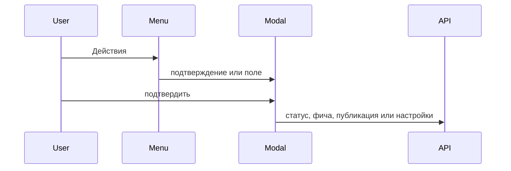

# Вернуть действия, кроме правки текста

Интерфейс снова создаёт и удаляет фичи, переносит ключевые файлы между статусами, публикует проект и сохраняет адрес с токеном в админке.

Текст документа с экрана не меняется. Нет кнопки «Исходный текст», нет сохранения тела файла и нет формы строки задачи. `PUT /api/document` клиент не вызывает.

Ввод идёт через модалку. Действие без полей сначала спрашивает подтверждение. Меню закрывается по клику снаружи.

