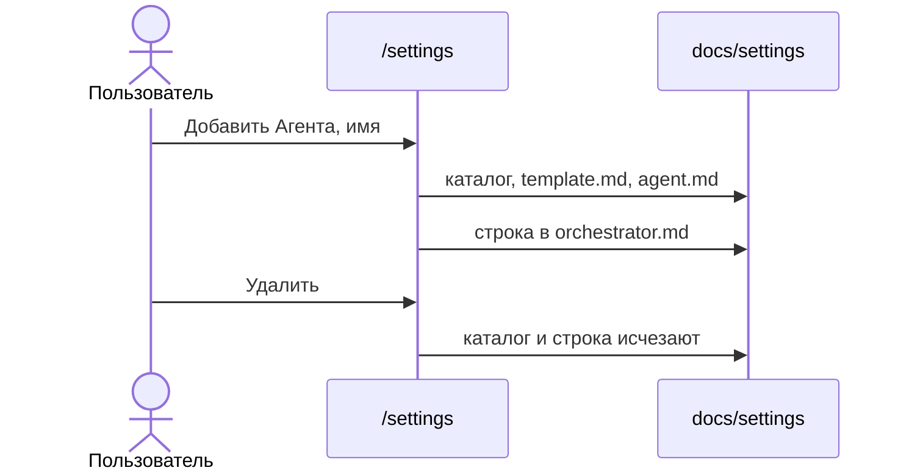

# Добавить и удалить агента

На экране `/settings` в бургере, под пунктом «Документация», стоит действие «Добавить Агента». Оно открывает окно с полем имени. Имя — kebab-case, то же правило, что у фичи.

Создание делает каталог `docs/settings/<имя>/` и два файла:

- `template.md` — заголовок `# {{feature}}`, строка `feature: {{feature}}`, строка `role: <имя>`
- `agent.md` — этот агент пишет только файл `<имя>.md` по соседнему `template.md` и не меняет набор разделов

В `orchestrator.md` в таблицу дописывается строка `| \`<имя>.md\` | \`docs/settings/<имя>/\` |`. Остальной текст оркестратора не переписывается.

Если каталог уже есть, ответ «Агент уже существует», файлы и таблица не меняются. Пустые настройки без `orchestrator.md` не чинятся молча: создание отвечает «Нет оркестратора».

У типа, открытого как каталог `docs/settings/<имя>`, в шапке есть «Удалить». Подтверждение: «Удалить агента?». Удаление убирает каталог и строку таблицы с путём `docs/settings/<имя>/`. Корень настроек и `orchestrator.md` этой кнопки не имеют.

