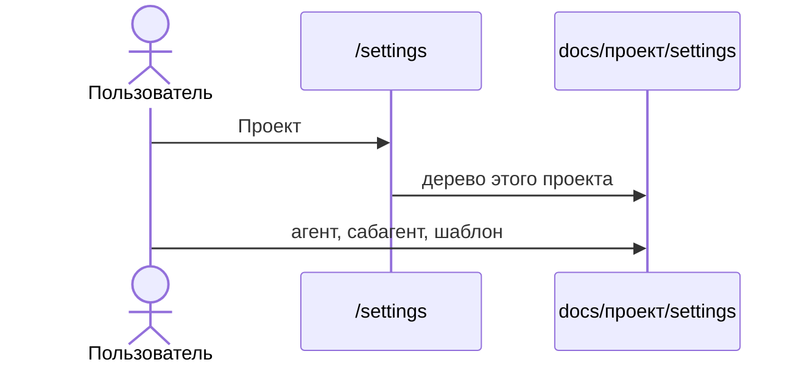

# Настройки внутри проекта

У каждого проекта свой каталог настроек. Агенты одного проекта не зависят от другого: текст агента не содержит имя проекта.

```text
docs/<проект>/settings/
  orchestrator.md
  <агент>/
    template.*
    agent.md
    <сабагент>/
      template.md
      agent.md
```

В таблицах оркестратора и агента путь записывается как `settings/<агент>/` и `settings/<агент>/<сабагент>/`, без `docs/` и без имени проекта. Один и тот же текст агента годится в любом проекте.

Селектор проектов и дерево фич каталог `settings` не показывают. Создание фичи берёт `template.*` только из `docs/<проект этой фичи>/settings`. Сабагенты по-прежнему не становятся документами фичи.

Страница `/settings` показывает тот же просмотр. В шапке селектор «Проект» переключает дерево на `docs/<выбранный проект>/settings`. Фильтры фичи и синхронизация на этой странице не появляются.

Текущее дерево `docs/settings` копируется в `billing` и `payments`, затем общий каталог удаляется. То же в фикстурах тестов.


