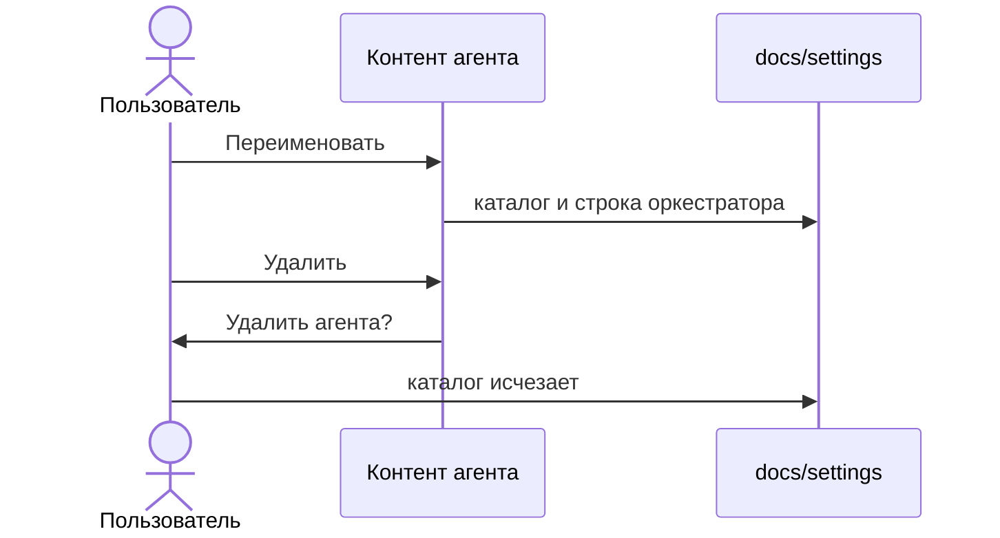

# Переименовать и удалить в контенте

В правой панели агента и сабагента, над списком файлов и над открытым файлом, стоят «Переименовать» и «Удалить». У агента рядом остаётся «Добавить сабагента».

Удаление по-прежнему спрашивает «Удалить агента?» или «Удалить сабагента?». Переименование открывает окно с текущим именем, «Отмена» и «Переименовать». Ошибка сервера остаётся в этом окне.

Имя — kebab-case. То же имя ничего не двигает. Занятое имя — «Агент уже существует» или «Сабагент уже существует».

Переименование агента переносит каталог `docs/settings/<старое>` в `docs/settings/<новое>`. В строке оркестратора путь становится `docs/settings/<новое>/`, а имя файла сохраняет прежнее расширение (`analyst.md` → `review.md`, `tester.yaml` → `qa.yaml`). Внутри перенесённого каталога в текстах `docs/settings/<старое>/` заменяется на `docs/settings/<новое>/`. В `template.md` самого агента строка `role: <старое>` становится `role: <новое>`.

Переименование сабагента переносит `docs/settings/<агент>/<старое>` и в `agent.md` родителя меняет имя и путь в строке таблицы. Оркестратор при этом не трогается.

