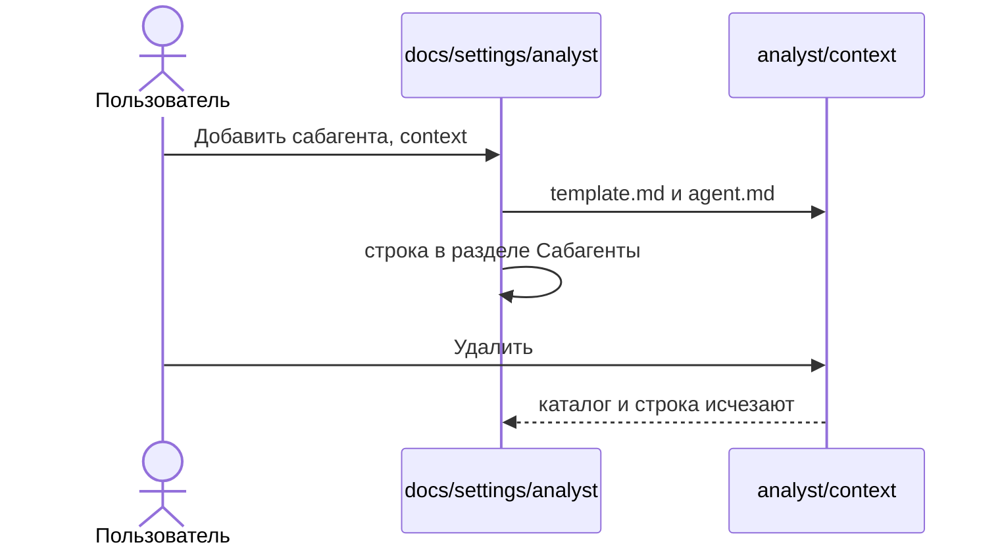

# Сабагенты агента

Сабагент — каталог внутри агента. Он делит работу этого агента и не становится отдельным типом документа фичи.

```text
docs/settings/<агент>/<сабагент>/
  template.md
  agent.md
```

Имя — kebab-case. В `agent.md` родителя, после уже написанного текста, появляется раздел, если его ещё нет:

```markdown
## Сабагенты

| Сабагент | Каталог |
|----------|---------|
| `<имя>` | `docs/settings/<агент>/<имя>/` |
```

Первый абзац `agent.md` не переписывается. Повторное имя — «Сабагент уже существует». Нет родительского каталога — «Агент не найден».

`template.md` сабагента — короткая заготовка части документа, не копия шаблона фичи. `agent.md` сабагента пишет только эту часть файла родителя и не добавляет типы документов. Создание фичи по-прежнему читает только `template.*` прямых каталогов `docs/settings` и не берёт шаблоны сабагентов.

На открытом каталоге агента, рядом с «Удалить», кнопка «Добавить сабагента». Окно спрашивает имя. На каталоге сабагента кнопка «Удалить» и подтверждение «Удалить сабагента?». Удаление убирает каталог и строку таблицы. Если строк не осталось, раздел «Сабагенты» тоже убирается.


