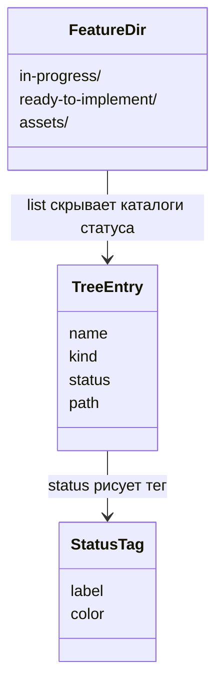
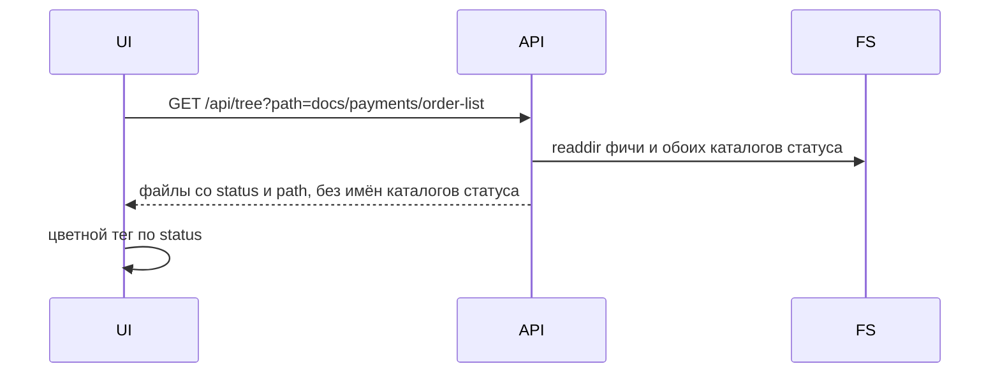

# Скрытые каталоги статуса

Каталоги статуса фичи называются `in-progress` и `ready-to-implement`. Визуализатор их не показывает. Статус файла и фичи рисуется цветным тегом.

## Имена

| Статус API | Каталог | Подпись тега | Цвет |
|------------|---------|--------------|------|
| `in_progress` | `in-progress` | В процессе | янтарный фон `#e8a317`, тёмный текст `#3d2914` |
| `ready` | `ready-to-implement` | Готово к реализации | зелёный фон `#1f7a4d`, светлый текст `#f6f4ef` |

Тег — скруглённая плашка (`status-tag`, плюс `status-tag-in-progress` или `status-tag-ready`).

## Поведение

Файл по-прежнему лежит в одном из двух каталогов. Смена статуса — `rename` в другой каталог. Фича готова, только когда все пять ключевых файлов лежат в `ready-to-implement`.

Дерево и правая панель каталога фичи не содержат строк `in-progress` и `ready-to-implement`. Всё содержимое этих каталогов сливается в саму фичу: каждый файл виден как файл фичи и открывается по реальному `path`. У файла со статусом есть цветной тег. Каталог `assets` и другие соседи фичи остаются на месте.

Открытие файла идёт по реальному пути `docs/<проект>/<фича>/<каталог-статуса>/<файл>`. В заголовке документа этот сегмент не показывается: виден путь фичи, имя файла и тег.

