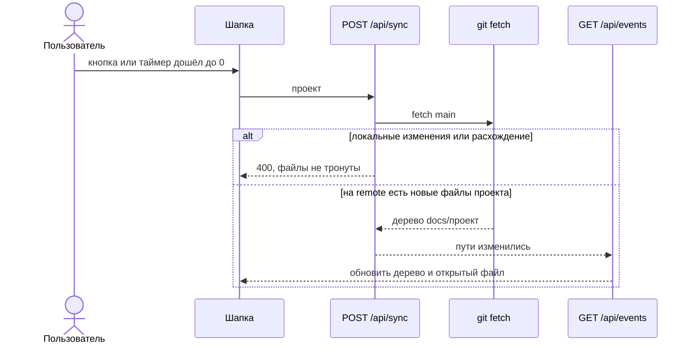

# Синхронизация и живые события

Источник правды — git-репозиторий проекта. Кнопка из двух круговых стрелок и таймер `1:00` вызывают одну и ту же синхронизацию выбранного проекта. Сервер шлёт события об изменившихся файлах, и открытый экран подхватывает их без перезагрузки.

Синхронизация обновляет только `docs/<проект>` из `main` адреса этого проекта. Остальные проекты в том же локальном репозитории не перезаписываются.

## Конфликт

- Нет адреса — «У проекта нет адреса репозитория».
- В `docs/<проект>` есть незакоммиченные изменения — «Сначала опубликуйте локальные изменения». Файлы не меняются.
- И локальные коммиты, и `main` меняли `docs/<проект>` — «Изменения разошлись с репозиторием». Слияния нет, файлы не меняются.
- Только `main` ушёл вперёд — файлы проекта становятся как на `main`, включая удаления.
- Токен из текста ошибки убирается.

Интервал таймера — 60 секунд. После ручного или автоматического вызова отсчёт начинается заново. Пока запрос идёт, кнопка не нажимается и таймер стоит.
