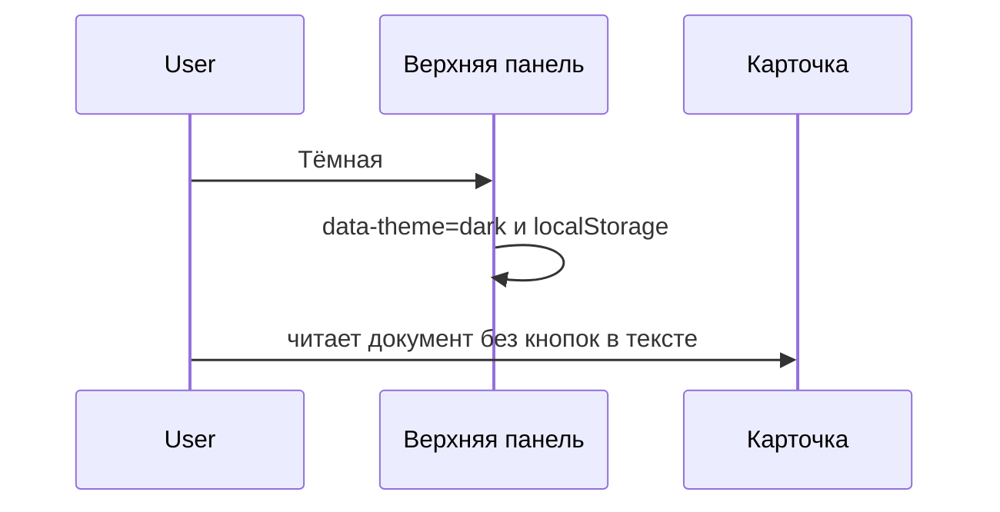

# Тема и верхняя панель

Светлая тема остаётся. Вторая тема — тёмная палитра Katran. Переключатель «Светлая» / «Тёмная» стоит в верхней панели и запоминает выбор.

Все действия собраны над содержимым и прижаты к краям. Слева — проект и путь. Справа — тема, админка, создание фичи, удаление, публикация и действия открытого файла. Дерево слева только навигирует. Текст документа лежит на карточке и не смешивается с кнопками.

