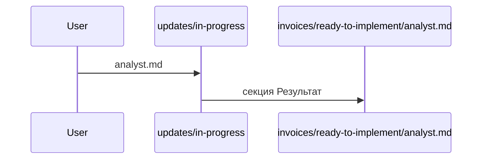

# Ссылка из файла изменения

Имя файла в строке `source:` открывает спеку фичи, а не соседний файл внутри `updates`. Ищутся каталоги `in-progress`, `ready-to-implement` и `done` самой фичи.

Если строка `section:` называет блок и ссылка ведёт на файл из `source:`, этот блок подсвечивается.

