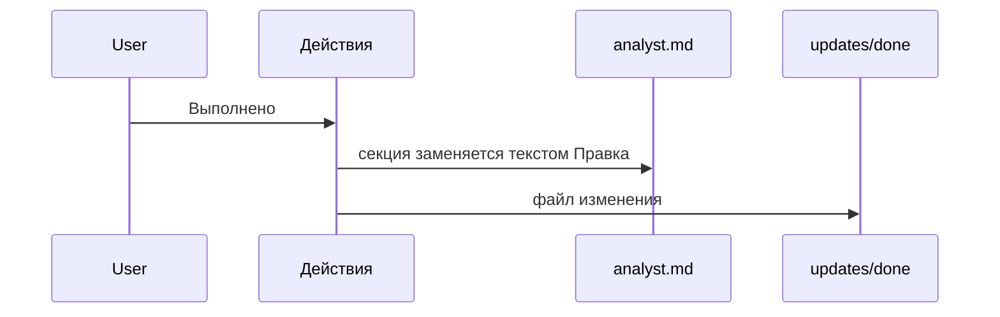

# Статус «Выполнено» у файла изменения

У файла в `updates/in-progress` в меню «Действия» есть пункт «Выполнено». Подтверждение то же: «Перенести файл в «Выполнено»?».

После подтверждения «Правка» заменяет секцию `section` в исходной спеке, а файл переезжает в `updates/done`. Если текущая секция уже не совпадает со снимком «Оригинал», перенос не выполняется.

У файла, который уже в `updates/done`, этого пункта нет. Другие статусы для файла изменения не предлагаются.

