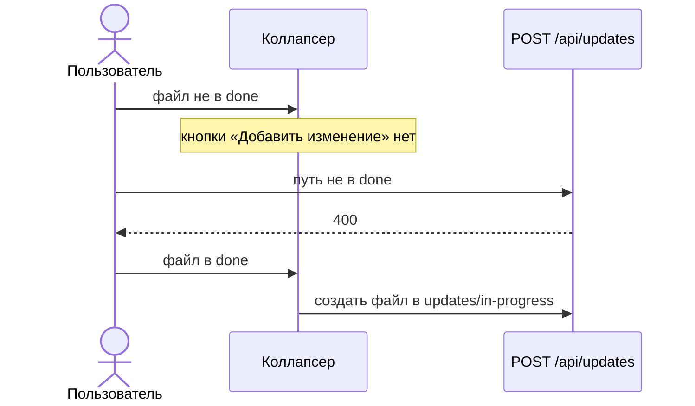

# Изменение только после «Выполнено»

Новый файл в `updates/in-progress` создаётся только для спеки из каталога `done`. Для файла в `in-progress` или `ready-to-implement` сервер отвечает 400, а кнопка «Добавить изменение» не показывается.

Уже созданное незакрытое изменение по-прежнему открывается кнопкой «Текущие изменения». Дата «Последние изменения» остаётся.

