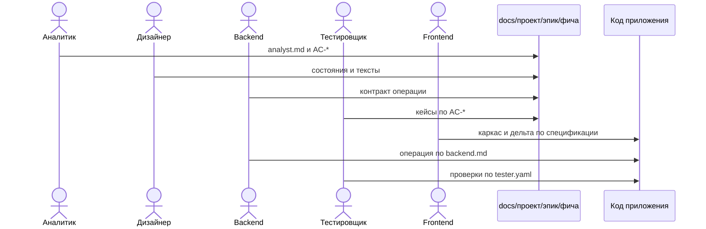

# sdd-visualizer

Репозиторий метода spec-driven development и визуализатора, в котором этот метод ведут.

Спецификация фичи пишется до кода и лежит в git рядом с работой. Пять ролей держат каждая свой файл. Код, тесты и ревью сверяются с этими файлами. Если в ходе реализации поведение оказывается другим, сначала меняется спецификация, затем код.

Визуализатор показывает это дерево, статусы и схемы. Сам он базу не использует: читает и пишет файлы. Продукт, который описывает спецификация, собирается на React, Nest SSR и PostgreSQL.

## Польза

Поведение задачи можно прочитать, не восстанавливая его из кода и переписки.

У каждой роли свой документ и свои критерии приёмки. Аналитик не правит контракт backend, дизайнер не назначает поля API, тестировщик не придумывает новые критерии.

Один `AC-*` проходит всю цепочку: формулировка, экран, операция, кейс, модуль. Ревью видит, какой критерий ещё не закрыт.

Агенты-имплементаторы получают те же файлы, что читает человек. Промпт роли уже лежит в настройках проекта и требует схему рядом с текстом.

## Как применять

Работа идёт по одному наблюдаемому результату: экран, форма, операция. Крупную задачу делят на такие результаты и кладут их в эпик.

1. Завести проект в `docs/<проект>/`. В `settings/` лежат шаблоны и промпты ролей. Этот каталог в дереве документации не показывается.
2. Создать эпик. Фича живёт только внутри эпика: `docs/<проект>/<эпик>/<фича>/`.
3. Создать фичу. В `in-progress/` появляются пять файлов из шаблонов проекта.
4. Заполнить файлы по порядку. Следующий файл появляется, когда артефакт предыдущей роли принят по своим критериям.

| Порядок | Роль | Файл | Что фиксирует |
|---------|------|------|----------------|
| 1 | Аналитик | `analyst.md` | Кто пользователь, какой результат виден, `AC-*`, границы, поля контракта, последовательность сценария |
| 2 | Дизайнер | `designer.md` | Состояния экрана, тексты, фокус, диаграмма состояний |
| 3 | Backend | `backend.md` | Операция Nest, поля, ошибки, PostgreSQL, вызов от клиента до базы |
| 4 | Тестировщик | `tester.yaml` | Кейс на каждый `AC-*`: что дано, что сделано, что должно получиться |
| 5 | Frontend | `frontend.md` | Страница, фича, SSR, эталон каталогов, команды каркаса, связи слоёв |

5. Перевести файл в «Готово к реализации», когда артефакт принят, и в «Выполнено», когда поведение уже в коде. Статус фичи считается по файлам сам.
6. Собрать приложение по спецификации: каркас из команд в `frontend.md` и `backend.md`, дельта только там, где генератор не закрывает поведение. Тесты закрывают `then` из `tester.yaml`.
7. Опубликовать документацию. Коммит перечисляет проекты, эпики и файлы. «Синхронизировать» подтягивает то, что уже есть в удалённом репозитории.

Агенту-имплементатору в другом репозитории отдают не копию, а ссылку: в меню документации «Добавить ссылку на документацию» создаёт symlink всего `docs/<проект>/` в выбранной папке вне этого репозитория.

Точечная правка, где результат уже описан тестом, идёт сразу в код. Спецификация обновляется, когда меняется то, что можно наблюдать.

Подробный цикл, уровни зрелости и вид каждого файла — в [методе](./docs/method/README.md).



## Что показывает визуализатор

Дерево начинается с эпиков. У фичи виден тег: «В процессе», «Готово к реализации», «Выполнено» или «Внесены изменения». Каталоги статуса в дереве скрыты.

Markdown читается разделами. Блок mermaid рисуется схемой. В шапке можно сузить дерево по эпику, фиче и статусу.

«Изменения» показывает, что в документации отличается от git, и публикует это одним коммитом. Настройки проекта — отдельные агенты, их копирование между проектами и шаблоны новых фич.

## Где лежат документы

```text
docs/<проект>/
  settings/                 промпты и шаблоны, в дереве скрыты
  <эпик>/
    <фича>/
      in-progress/
      ready-to-implement/
      done/
      assets/
      updates/
```

Критерии приёмки файлов — `AN-*`, `DS-*`, `BE-*`, `QA-*`, `FE-*`. Критерии поведения фичи — только `AC-*` в `analyst.md`.

## Запуск

```bash
npm install
npm run start:mock
```

Сервер заново копирует `apps/server/test/fixtures` в `data/mock` и открывает http://localhost:3000. Локальные правки в `data/mock` при этом пропадают.

Свои документы лежат в `docs/` этого репозитория. Чтобы визуализатор читал их, после сборки запустите сервер с корнем репозитория:

```bash
DOCS_ROOT="$PWD" node apps/server/dist/main.js
```

## Куда читать дальше

| Документ | Зачем |
|----------|--------|
| [Метод](./docs/method/README.md) | С чего начать чтение метода |
| [Теория](./docs/method/01-theory.md) | Что такое спецификация и цикл одного изменения |
| [Зрелость](./docs/method/02-maturity.md) | Уровни от «код первичен» до исполнимой спецификации |
| [Переходы](./docs/method/03-transitions.md) | Когда команда переходит на следующий уровень |
| [Роли](./docs/method/04-roles.md) | Кто что пишет на каждом уровне |
| [Репозиторий документов](./docs/method/05-docs-repo.md) | Вид файлов и критерии приёмки артефактов |
