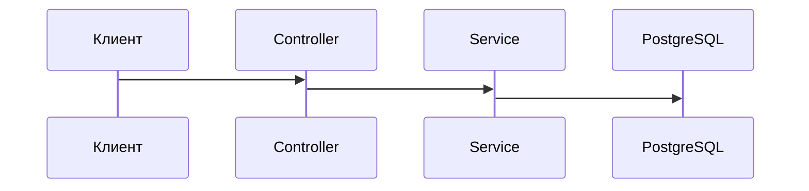

# {{feature}}

feature: {{feature}}
role: backend
depends:
  - analyst.md
  - designer.md

## Операция
- метод: 
- путь: 

## Запрос
| Поле | Тип | Обязательность | AC |
|------|-----|----------------|----|
| | | | |

## Пример запроса
```json
{
  "day": "2026-10-21"
}
```

## Ответ
| Поле | Тип | AC |
|------|-----|----|
| | | |

## Пример ответа
```json
[
  {
    "number": "ORD-001",
    "amount": "1000.00",
    "status": "paid"
  }
]
```

## Ошибки
| HTTP | Код | Состояние из designer.md | Когда |
|------|-----|--------------------------|-------|
| | | | |

## Правила сервера
- 

## Эффекты
- 

## Данные
| Таблица PostgreSQL | Сущность TypeORM | Миграция |
|--------------------|------------------|----------|
| | | |

## Источник контракта
- модуль: 
- controller: 
- DTO запроса и ответа: 

## Схема



## Критерии приёмки артефакта
| ID | Критерий |
|----|----------|
| BE-1 | В шапке указаны feature-id и зависимости от analyst.md и designer.md. |
| BE-2 | Метод и путь совпадают с контрактом в analyst.md. |
| BE-3 | Каждое поле аналитического контракта есть в запросе или ответе. |
| BE-4 | Состояния ошибки, валидации, отсутствия прав и пустоты описаны. |
| BE-5 | Правила сервера называют валидацию и пустой результат. |
| BE-6 | Эффекты называют строки PostgreSQL. |
| BE-7 | В данных названы таблица, сущность и миграция. В файле нет слоёв экрана. |
| BE-8 | Файл не выпускает новых AC-*. |
| BE-9 | В «Схеме» sequenceDiagram вызова: клиент, controller, сервис, PostgreSQL. |
