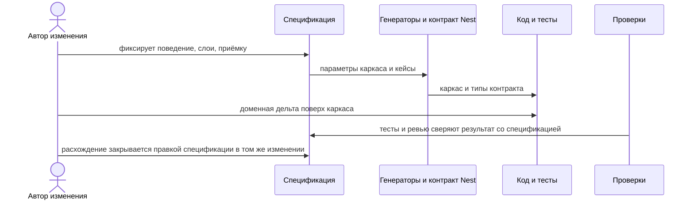
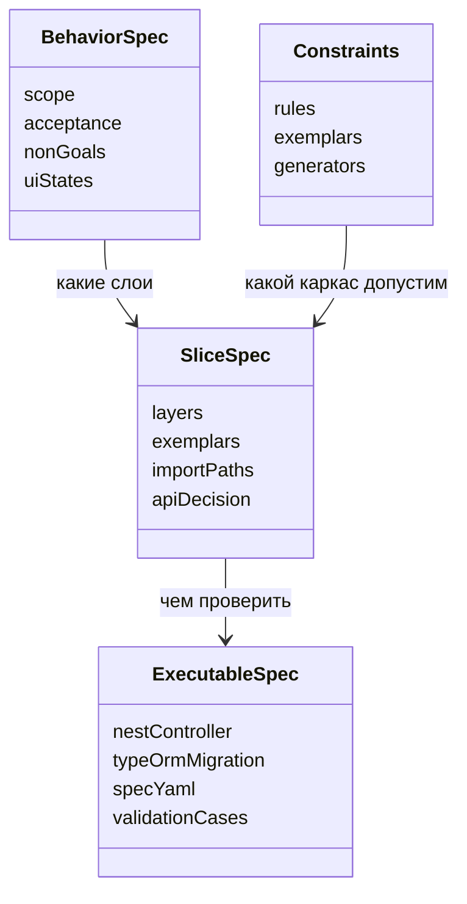
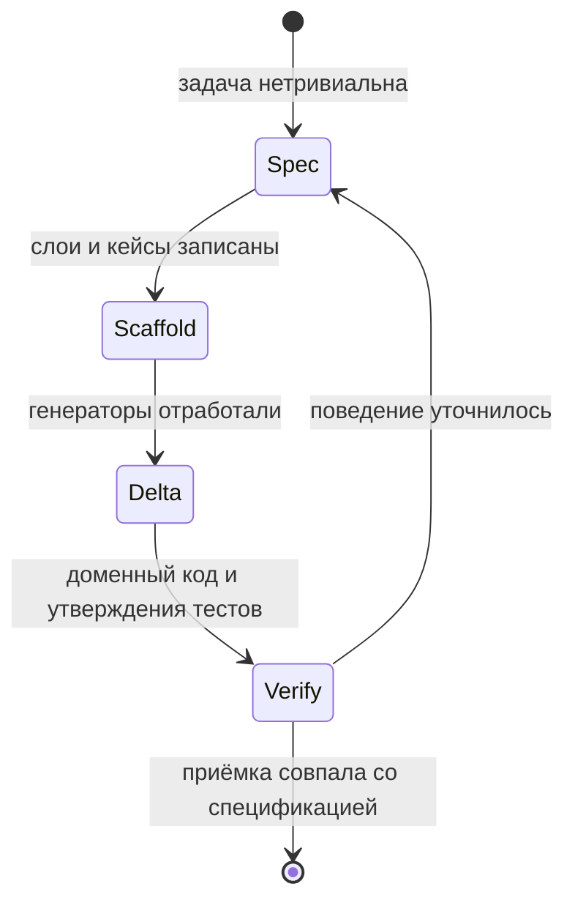

# Теория spec-driven development

## Определение

Spec-driven development (SDD) — способ вести изменение так, чтобы решение о поведении было записано в репозитории раньше, чем появится основной код. Метод ниже описан для приложения на **React**, **Nest SSR** и **PostgreSQL**: первый HTML отдаёт Nest через серверный рендер React, данные хранит PostgreSQL через TypeORM в Nest.

Спецификация отвечает на четыре вопроса:

1. Какое поведение получает пользователь или вызывающий код.
2. Какие слои и контракты это поведение реализуют.
3. Какие случаи считаются приёмкой, включая ошибки и пустые состояния.
4. Какими командами каркас и проверки воспроизводятся.

Код, тесты и ревью выводятся из спецификации и сверяются с ней. Если в ходе работы выясняется другое поведение, сначала обновляется спецификация, затем реализация.

Уровень зрелости команды — это то, насколько полно цикл выше является нормой, а не разовым усилием. Критерии уровней — в [02-maturity.md](./02-maturity.md).

## Из чего состоит спецификация

Спецификация задачи — набор артефактов разной жёсткости. Все они лежат в git и меняются вместе с поведением.

### Поведение

Поведение пишет аналитик в `docs/<проект>/<эпик>/<фича>/{in-progress|ready-to-implement|done}/analyst.md` репозитория документации. Минимальный состав:

- контекст и границы задачи;
- наблюдаемый результат;
- критерии приёмки с устойчивыми идентификаторами (`AC-1`, `AC-2`);
- явные non-goals;
- метод, путь и поля контракта, от которых зависит результат;
- таблица задач: номер, скриншот и ссылка на дизайн Pixo, описание.

Документ остаётся коротким. Он называет наблюдаемый результат и приёмку. Пошаговое описание компонентов в него не входит. Матрицу состояний пишет дизайнер в `designer.md`.

### Срез архитектуры

Контракт операции, сущность TypeORM, таблица PostgreSQL и миграция пишет backend в `backend.md`. Слои страницы, SSR и эталон каталогов пишет frontend в `frontend.md`. Для экрана срез называется явно:

1. `apps/web/src/pages/<Page>/` — маршрут, состояния страницы, props гидрации.
2. `apps/web/src/features/<feature>/` — сценарий экрана: форма, действия, вызовы контроллера Nest после гидрации.
3. `apps/web/src/shared/` — общие компоненты и клиент к API Nest (только если нужен вне страницы).
4. `apps/server/src/<feature>/` — Nest-модуль: controller, service, DTO.
5. `apps/server/src/ssr/` — маршрут SSR, `renderToPipeableStream`, данные первого рендера.
6. `apps/server/src/database/` — сущность TypeORM и миграция, если операция меняет таблицу.

Страница без своего сценария не заводит пустую фичу. Операция без таблицы не заводит сущность TypeORM. Клиент React вызывает тот же контроллер Nest, что описан в `backend.md`; отдельный сгенерированный клиент не является источником типов.

### Исполняемые части

| Артефакт | Что фиксирует | Как исполняется |
|----------|----------------|-----------------|
| Контроллер Nest и DTO | Форма запроса и ответа | реализация в `apps/server/src/<feature>/` |
| Миграция TypeORM | Таблица PostgreSQL и сущность | `migration:run` против PostgreSQL |
| `tester.yaml` | Кейсы по `AC-*`, команды проверок | тесты в репозитории кода по полю `code_test` |
| `backend.md` | Операция, поля, ошибки, эффекты, сущность | модуль Nest и DTO; Swagger из DTO при необходимости |
| `frontend.md` | Страница, фича, SSR-маршрут, Nest-модуль | команды каркаса и сборки SSR |
| Схема валидации | Правила формы | кейсы `kind: auto` в `tester.yaml` |

`tester.yaml` материализует уже названные случаи. Утверждения внутри тестов дописываются по `then`. Генератор каркаса не заменяет спецификацию поведения.

### Постоянные ограничения

Правила репозитория и эталонные каталоги действуют на все задачи. Их не копируют в каждую спецификацию. В `frontend.md` указывают эталон и только отклонение от него с причиной. В `backend.md` указывают путь к Nest-модулю и DTO как источник контракта.

В цикле участвуют пять ролей. Каждая владеет своим файлом в директории фичи. Вид файлов и приёмка артефактов — в [05-docs-repo.md](./05-docs-repo.md). Ответственность по уровням зрелости — в [04-roles.md](./04-roles.md).

| Роль | Файл |
|------|------|
| Аналитик | `analyst.md` — контекст, результат, `AC-*`, non-goals, поля контракта |
| Дизайнер | `designer.md` — состояния, тексты, действия, доступность |
| Backend | `backend.md` — операция, поля, ошибки, эффекты, сущность TypeORM, миграция, источник контракта Nest |
| Тестировщик | `tester.yaml` — кейсы `api` и `ui`, команды проверок, связь `AC-*` с тестом |
| Frontend | `frontend.md` — page, feature, server module, ssr, эталон, команды каркаса и сборки, дельта |

## Цикл одного изменения

1. **Зафиксировать поведение.** Аналитик пишет `analyst.md`: границы, приёмка, non-goals, контракт. Дизайнер пишет `designer.md`: состояния и тексты.
2. **Назвать контракт и проверки.** Backend пишет `backend.md`. Тестировщик пишет кейсы в `tester.yaml` с теми же `id`, что и `AC-*`. Frontend записывает в `frontend.md` команды генераторов с параметрами фичи.
3. **Собрать каркас.** Nest CLI и команды каркаса создают модуль, страницу и SSR-маршрут, которых ещё нет. Миграция TypeORM описывает схему. Ручной код на этом шаге — только то, чего генератор не покрывает.
4. **Дописать дельту.** Маппинг DTO, тексты, ветки валидации, состояния, вызовы контроллера после гидрации. Заготовки кейсов заменяются проверками из приёмки.
5. **Сверить.** Тесты по затронутым путям в `apps/server` и `apps/web`, применение миграций к PostgreSQL, сборка SSR для экранных изменений. Ревью читает спецификацию и дифф вместе.
6. **Обновить спецификацию в том же изменении**, если реализация выбрала другое поведение.

Точечная правка модуля, где поведение уже описано тестом, идёт сразу в код. Спецификация обновляется, когда меняется наблюдаемый результат.

## Зерно спецификации

Одна спецификация покрывает один наблюдаемый результат: экран, сценарий вкладки, форму, справочник.

Крупная задача делится на несколько таких спецификаций. Общие правила слоёв остаются в постоянных ограничениях. В спецификацию задачи попадает решение этой задачи.

Имена критериев приёмки стабильны. Тест может называться иначе, но в `tester.yaml` у кейса тот же `id`, что и у `AC-*`.

## Что держит спецификация

| В спецификации | В коде |
|----------------|--------|
| Наблюдаемое поведение и приёмка | Компоненты React, сервис Nest, сущность TypeORM |
| Слои, эталон, SSR-маршрут | Импорты и композиция |
| Состояния UI и тексты ошибок | Разметка |
| Имена кейсов и команды генерации | Тела тестов и моки |
| Поля контракта, важные для сценария | DTO и контроллер Nest в коде |

## Шаблоны файлов

Вид `analyst.md`, `designer.md`, `backend.md`, `tester.yaml` и `frontend.md`, а также критерии приёмки каждого файла — в [05-docs-repo.md](./05-docs-repo.md).
