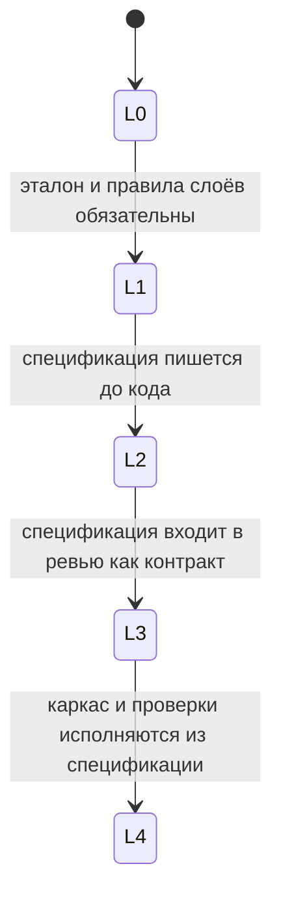

# Уровни зрелости SDD

Уровень описывает устойчивую практику: одна и та же дисциплина держится на серии нетривиальных задач. Отдельная удачная спецификация и установленный инструмент уровень не задают.

Уровни накопительные. Критерии уровня N выполнены только вместе с критериями всех предыдущих уровней.

Нетривиальной считается задача, в которой появляется или заметно меняется экран, таблица, фильтр, дровер или форма; меняется контракт или набор полей, видимых пользователю; затрагиваются два слоя и больше; работу ведут аналитик, дизайнер, backend, тестировщик и frontend.

Точечная правка текста или условия в модуле, где поведение уже покрыто тестом, остаётся внутри текущего уровня. Смена наблюдаемого результата обновляет спецификацию того уровня, на котором команда работает.

## Сводка

| Уровень | Имя | Источник поведения | Чем закрыта приёмка |
|---------|-----|--------------------|---------------------|
| 0 | Код первичен | Решение в момент написания кода | Просмотр результата |
| 1 | Ограничения и эталоны | Внешнее описание задачи и названный эталон | Тесты рядом с кодом |
| 2 | Локальная спецификация | Четыре файла директории фичи до реализации | Кейсы в `tester.yaml` |
| 3 | Контракт изменения | Спецификация, совпадающая с результатом на момент включения | Каждый `AC-*` закрыт проверкой |
| 4 | Исполняемая спецификация | Спецификация, из которой повторяются каркас и проверки | Команды спецификации, исполненные проверками |

## Уровень 0. Код первичен

Поведение выбирается во время реализации. Место файлов определяется ближайшим похожим каталогом. Проверка появляется по итогам просмотра готового кода.

### Критерии

Уровень 0 имеет место, когда на нетривиальных задачах выполнено всё нижеследующее:

1. До изменения кода нет записанных границ, результата и критериев приёмки.
2. Слой выбирается по сходству с соседним экраном, а не по названному эталону.
3. Одинаковые по смыслу экраны и формы устроены разными способами.
4. DTO и сущности TypeORM правятся только в коде Nest, без записи в спецификации.
5. Тесты либо отсутствуют, либо описывают уже написанную реализацию без заранее названного результата.

## Уровень 1. Ограничения и эталоны

Команда знает, куда класть код и с какого образца его собирать. Поведение конкретной задачи живёт во внешнем описании: тикет, сообщение, устное пояснение.

### Критерии

1. Новая страница и новый экран повторяют названный эталон своих слоёв: page, feature, Nest-модуль, SSR, при необходимости сущность TypeORM.
2. Импорты идут в модуль, который объявляет символ. Публичные точки входа ограничены установленными правилами.
3. Контракт операции назван во внешнем описании задачи: Nest controller, DTO и при хранении данных — таблица PostgreSQL.
4. Миграция TypeORM, если нужна, генерируется и включается в изменение.
5. Тесты лежат в одном каталоге с единицей, которую проверяют.
6. В репозитории нет спецификации поведения, написанной до кода этой задачи. Сравнить дифф можно с тикетом или перепиской, не с файлом приёмки в git.

Уровень сохраняет свободу поведения: слои предсказуемы, результат задачи заранее в репозитории не зафиксирован.

## Уровень 2. Локальная спецификация

Нетривиальное изменение начинается с файла в репозитории. Код пишется после того, как названы результат, границы, слои и кейсы.

### Критерии

1. До основного кода в `docs/<проект>/<эпик>/<фича>/in-progress/`, `docs/<проект>/<эпик>/<фича>/ready-to-implement/` или `docs/<проект>/<эпик>/<фича>/done/` есть `analyst.md`, принятый по AN-1…AN-9: контекст, результат, non-goals, `AC-*`, таблица задач и sequenceDiagram сценария.
2. В `backend.md` названы операция, поля, ошибки, сущность TypeORM, источник контракта Nest и sequenceDiagram вызова, артефакт принят по BE-1…BE-9 до кода операции. В `frontend.md` названы page, feature, server module, ssr и эталон, артефакт принят по FE-1…FE-7 до дельты экрана; FE-8…FE-11 — на дельте. FE-11 — classDiagram слоёв.
3. Для экрана `designer.md` содержит матрицу состояний и принят по DS-*. Для сценария без экрана в нём стоит `ui: none`, а входы и выходы заданы в `analyst.md`.
4. Кейсы `tester.yaml` названы до ручного написания тестов, несут те же `id`, что и `AC-*`, и приняты по QA-1…QA-7.
5. Для нового повторяемого каркаса в `frontend.md` записаны команды генерации с параметрами этой фичи, и каркас получен этими командами. Контракт операции получен из источника, названного в `backend.md`.
6. Директория фичи покрывает один наблюдаемый результат.

На этом уровне спецификация — исходное решение автора. К моменту включения в основную ветку она может разойтись с кодом: обязательной сверки на ревью ещё нет. Эту сверку добавляет уровень 3.

## Уровень 3. Контракт изменения

Спецификация живёт столько же, сколько поведение. Изменение включается в основную ветку, когда спецификация, код и проверки описывают один и тот же результат.

### Критерии

1. `analyst.md`, `designer.md`, `backend.md`, `tester.yaml` и `frontend.md` входят в то же изменение, что и реализация, и ссылаются на один `feature-id`.
2. Каждый `AC-*` связан с кейсом в `tester.yaml`. Для DTO, валидации, сервиса Nest и клиента React у кейса `kind: auto` и заполнен `code_test`. Для экрана допустим `kind: manual`.
3. Ревью читает спецификацию и сравнивает её с диффом. Расхождение закрывается до включения: правкой кода по спецификации или правкой спецификации, если решение о поведении изменилось.
4. Смена наблюдаемого поведения видна как правка `AC-*` в том же изменении.
5. Для контрактной задачи порядок фиксирован: правка `backend.md`, Nest-модуль и DTO, миграция TypeORM при необходимости, страница React и SSR-маршрут.
6. Матрица состояний в спецификации совпадает с ветками интерфейса, которые есть в изменении.
7. Описание изменения ссылается на спецификацию и перечисляет закрываемые `AC-*`.

Спецификация остаётся прозой и yaml. Команды из раздела «Каркас» запускает человек или агент. Доказательство, что запущены именно эти команды, появляется на уровне 4.

## Уровень 4. Исполняемая спецификация

По спецификации повторяются каркас и набор проверок. Изменение поведения начинается с правки спецификации, и эта правка даёт дифф каркаса или списка кейсов.

### Критерии

1. Секции спецификации однозначно соответствуют командам каркаса Nest-модуля, миграции TypeORM, сборки SSR и генерации тестов.
2. Повторный запуск этих команд на путях задачи воспроизводит каркас и сохраняет доменную дельту.
3. Список кейсов в `tester.yaml` совпадает с `AC-*`. В включённом изменении нет кейса с пустыми `given`, `when` или `then`.
4. Проверки, названные в спецификации, исполняются на изменённых путях автоматически.
5. Новая автоматическая проверка утверждает поведение из `AC-*`. Проверка, которая только подключает модуль, критерий приёмки не закрывает.
6. Вход агента — путь к спецификации и границы из non-goals. Требования собираются из этого файла.
7. Повторяемый трижды приём каркаса или теста живёт в генераторе. Следующие спецификации получают тот же каркас.

Доменная дельта остаётся ручной: маппинг полей, тексты, особые ветки. Из спецификации исполняется то, что шаблонизировано: слои, каркас, типы контракта, имена и форма проверок.

## Различие соседних уровней

| Вопрос | 0 | 1 | 2 | 3 | 4 |
|--------|---|---|---|---|---|
| Где записано поведение до кода | Нигде | Во внешнем описании | В `analyst.md` директории фичи | В файлах фичи, совпадающих с включённым результатом | В файлах фичи, из которых запускаются команды |
| Что задаёт слой | Соседний код | Названный эталон | Раздел «Слои» | Сверка раздела «Слои» на ревью | Генератор этого каркаса |
| Когда появляются проверки | После кода или отсутствуют | Вместе с кодом | Кейсы названы до кода | Каждый `AC-*` закрыт | Кейсы исполняются, заготовок нет |
| Как меняется поведение | Правкой кода | Правкой кода | Правкой кода; spec могут обновить | Правкой `AC-*` в том же изменении | Сначала spec, затем порождённый дифф |

## Что подтверждает уровень

Ответственность аналитика, дизайнера, backend, тестировщика и frontend на каждом уровне — в [04-roles.md](./04-roles.md).

Уровень подтверждается серией нетривиальных задач, на которых выполнены все его критерии. Подтверждением не являются:

- наличие правил и генераторов при задачах, которые им не следуют;
- одна спецификация при остальных задачах без неё;
- генерация тестов по уже написанному коду без заранее названных `AC-*`;
- длинный описательный документ без приёмки и без обновления вместе с поведением;
- успешный прогон тестов, которые фиксируют реализацию и не ссылаются на критерии приёмки.
