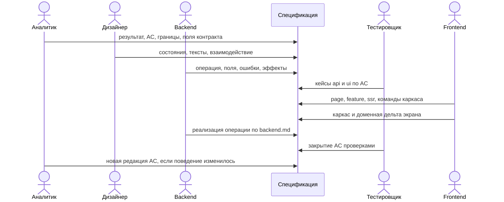
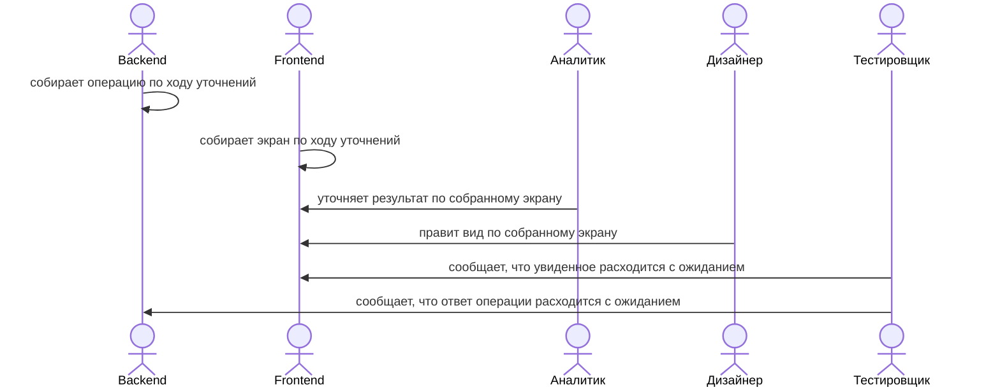
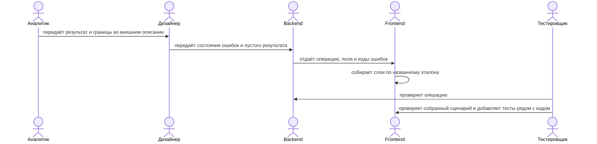
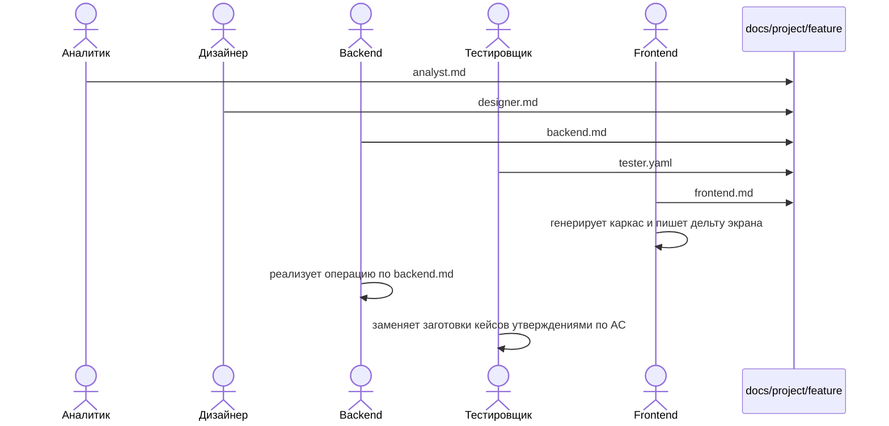
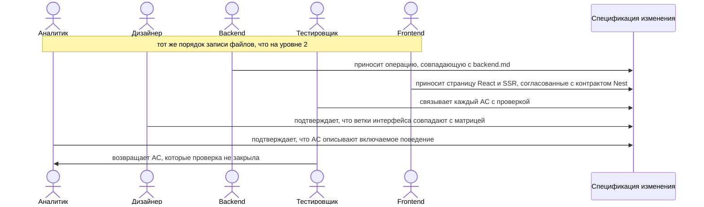
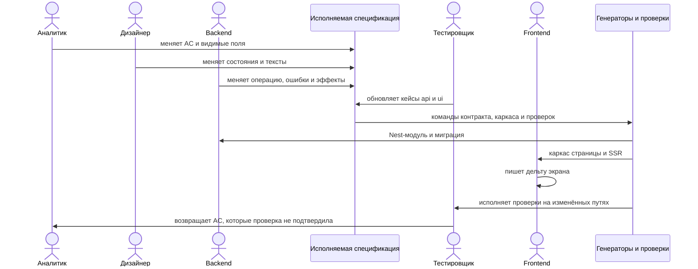

# Роли в цикле SDD

В изменении участвуют пять ролей: аналитик, дизайнер, backend, тестировщик, frontend. Роль задаёт, каким файлом она владеет и в какой момент передаёт работу дальше. Один человек может совмещать роли. Совмещение не сливает файлы: приёмка, состояния, контракт API, кейсы и экран по-прежнему записываются отдельно и в своём порядке.

С ростом уровня меняется носитель передачи. На уровне 0 роли обмениваются устными уточнениями. На уровне 1 носитель — внешнее описание задачи. С уровня 2 носитель — директория фичи в отдельном репозитории документации: у каждой роли свой файл. На уровне 3 эти файлы совпадают с включённым результатом. На уровне 4 правка файла роли запускает каркас и проверки. Вид файлов и приёмка артефактов — в [05-docs-repo.md](./05-docs-repo.md).

## Чем владеет роль

| Роль | Владеет | Передаёт дальше |
|------|---------|-----------------|
| Аналитик | Контекст, наблюдаемый результат, `AC-*`, non-goals, поля контракта, которые видит пользователь | Зафиксированное поведение |
| Дизайнер | Матрица состояний, тексты, порядок действий, фокус, клавиатура, доступные имена элементов | Поведение, которое можно собрать и проверить на экране |
| Backend | Операция Nest, поля запроса и ответа, ошибки, правила сервера, эффекты, сущность TypeORM, миграция PostgreSQL, источник контракта (модуль и DTO) | Контракт, по которому собираются кейсы и экран |
| Тестировщик | Кейсы по `AC-*` на поверхностях `api` и `ui`, команды проверок, связь критерия с проверкой | Названные и выполненные проверки |
| Frontend | Страница React, фича экрана, SSR-маршрут, Nest-модуль по `backend.md`, эталон каталогов, команды каркаса и сборки SSR, доменная дельта | Экран, который Nest SSR отдаёт и который после гидрации показывает записанное поведение |

Этот порядок — флоу парадигмы. Ниже для каждого уровня расписано, как тот же порядок выглядит, пока часть шагов ещё живёт вне спецификации, и какие обязанности выполняют роли.

## Уровень 0. Код первичен

Носитель передачи — разговор и готовый код. Спецификации в репозитории нет, поэтому роли уточняют поведение по уже собранному экрану.

### Флоу

### Ответственность

| Роль | Что делает на этом уровне |
|------|---------------------------|
| Аналитик | Формулирует задачу устно или коротким внешним текстом и отвечает на вопросы во время разработки. Приёмку называет после просмотра результата. |
| Дизайнер | Показывает желаемый вид отдельно от кода и сверяет его с уже собранным экраном. Состояния загрузки, пустоты и ошибки договариваются в момент появления на экране. |
| Тестировщик | Проверяет собранный сценарий вручную. Замечания описывают найденное поведение. Набор проверок складывается из того, что успели посмотреть. |
| Backend | Собирает операцию по ближайшему похожему API и меняет поля и коды ошибок по замечаниям после просмотра. |
| Frontend | Выбирает каталоги по соседнему экрану, пишет поведение и поправляет экран по замечаниям остальных ролей. |

Роль на этом уровне исполнена, когда участник передал своё уточнение по готовому результату. Записи поведения до кода от роли не требуется.

## Уровень 1. Ограничения и эталоны

Носитель передачи — внешнее описание задачи. Frontend дополнительно связан эталоном слоёв, backend — опубликованным контрактом. Порядок ролей появляется, но приёмка остаётся вне репозитория документации.

### Флоу

### Ответственность

| Роль | Что делает на этом уровне |
|------|---------------------------|
| Аналитик | Пишет внешнее описание: кто пользуется сценарием, какой результат считается готовым, что в задачу не входит. Поля, которые видит пользователь, называет до сборки. |
| Дизайнер | Прикладывает к описанию компоновку, подписи и порядок действий. Для таблицы, фильтра, дровера и формы указывает основные экраны сценария. |
| Тестировщик | Составляет проверки по внешнему описанию и проводит их на собранном сценарии. Автоматические тесты кладёт в каталог единицы. Кейсы дописывает вместе с кодом или сразу после него. |
| Backend | Публикует операцию по внешнему описанию: метод, путь, поля, ошибки и эффект. |
| Frontend | Называет эталон, раскладывает код по слоям page и feature, подключает SSR-маршрут и собирает страницу React по внешнему описанию и контракту backend. |

Роль исполнена, когда её выход приложен к внешнему описанию, операция backend опубликована, а экран frontend повторяет эталон. Файла приёмки в репозитории документации до кода по-прежнему нет.

## Уровень 2. Локальная спецификация

Носитель передачи — директория `docs/<проект>/<фича>/` в репозитории документации. Файл роли лежит в `in-progress`, `ready-to-implement` или `done`. Роль добавляет свой файл до основного кода и только после приёмки предыдущего артефакта.

### Флоу

### Ответственность

| Роль | Что делает на этом уровне |
|------|---------------------------|
| Аналитик | Создаёт директорию фичи и `analyst.md` в `in-progress`. Заполняет контекст, результат, `AC-*`, non-goals, поля контракта и таблицу задач. Файл принят по AN-1…AN-8. |
| Дизайнер | Добавляет `designer.md` с покрытием `AC-*`, шестью состояниями, текстами и фокусом. Для сценария без экрана ставит `ui: none`. Файл принят по DS-1…DS-7. |
| Backend | Добавляет `backend.md`: операция Nest, поля, ошибки по состояниям дизайнера, правила сервера, эффекты, таблица PostgreSQL, сущность TypeORM, миграция и путь к модулю и DTO. Файл принят по BE-1…BE-8. |
| Тестировщик | Добавляет `tester.yaml`: на каждый `AC-*` кейс с `surface`, `given` / `when` / `then` и команды в `checks`. До кода файл принят по QA-1…QA-7. |
| Frontend | Добавляет `frontend.md`: page, feature, server module, ssr, эталон, трассировку `AC-*` и команды каркаса и сборки SSR. Файл принят по FE-1…FE-10. Страницу React и SSR пишет в репозитории приложения. |

Роль исполнена, когда её файл есть в директории фичи до появления доменного кода. Сверка спецификации с итоговым диффом на включении — обязанность уже следующего уровня. Если во время дельты выясняется другое поведение, аналитик обновляет `AC-*`, дизайнер обновляет затронутые состояния, backend обновляет контракт, тестировщик обновляет кейсы, и только затем frontend и backend меняют код.

## Уровень 3. Контракт изменения

Флоу уровня 2 сохраняется. К нему добавляется общее подтверждение перед включением изменения: спецификация, код и проверки описывают один результат.

### Флоу

### Ответственность

| Роль | Что делает на этом уровне |
|------|---------------------------|
| Аналитик | Удерживает `AC-*` как источник поведения до включения. Любую смену наблюдаемого результата оформляет правкой критериев в том же изменении. В описании изменения указывает спецификацию и список закрываемых `AC-*`. |
| Дизайнер | На сверке подтверждает матрицу состояний по фактическим веткам интерфейса. Новое состояние добавляет в матрицу в том же изменении, вместе с текстом и правилом доступности. |
| Backend | Включает операцию только вместе с `backend.md`. Расхождение ответа и документа закрывает правкой кода либо правкой `backend.md`, если аналитик уже изменил `AC-*`. |
| Тестировщик | Связывает каждый `AC-*` с кейсом `surface: api` или `surface: ui`. Для контракта Nest, DTO, валидации и клиента React связь ведёт на автоматическую проверку. Незакрытый критерий возвращает аналитику, backend или frontend до включения. |
| Frontend | Включает экран только вместе с директорией фичи. Порядок контрактной задачи: `backend.md`, Nest-модуль и DTO, миграция TypeORM при необходимости, страница и SSR. Расхождение экрана со спецификацией закрывает правкой кода либо передаёт правку владельцу файла. |

Роль исполнена, когда на включении её файл совпадает с результатом и с проверками. Замечание о другом поведении закрывает владелец файла: аналитик правит критерий, дизайнер — состояние, backend — контракт, тестировщик — связь с проверкой, frontend — экран.

## Уровень 4. Исполняемая спецификация

Правка файла роли порождает следующий артефакт. Аналитик меняет поведение правкой `AC-*`. Дизайнер меняет экран правкой матрицы. Backend меняет контракт правкой операции. Тестировщик получает кейсы из этих формулировок. Frontend получает каркас из команд `frontend.md`.

### Флоу

### Ответственность

| Роль | Что делает на этом уровне |
|------|---------------------------|
| Аналитик | Начинает изменение с правки результата и `AC-*`. Формулирует критерии так, чтобы из них следовали кейсы и видимые поля контракта. Границы в non-goals ограничивают вход backend, frontend и агента. |
| Дизайнер | Держит матрицу состояний в файле, из которого собирается интерфейсный каркас и из которого тестировщик берёт сценарии прохода состояний. Текст и имя элемента, важные для проверки, записаны в спецификации. |
| Backend | Держит в `backend.md` операцию Nest, сущность и миграцию. Повторяемое описание ошибки и поля живёт в DTO и сервисе; Swagger при необходимости выпускается из DTO через `@nestjs/swagger`. |
| Тестировщик | Поддерживает список кейсов, совпадающий с `AC-*`, отдельно для `api` и `ui`. Команды проверок из спецификации исполняются на изменённых путях. Закрытым считается критерий, по которому проверка утверждает поведение. Проверка, которая только подключает модуль, остаётся незакрытым критерием. |
| Frontend | Записывает команды генерации так, чтобы повторный запуск воспроизводил каркас и сохранял дельту экрана. Повторяемый трижды приём переносит в генератор. В дельте остаются маппинг, тексты из спецификации и особые ветки. |

Роль исполнена, когда изменение её файла само запускает следующий шаг флоу: правка аналитика видна в кейсах, правка дизайнера видна в состояниях, правка backend видна в Nest-модуле и миграции, кейсы тестировщика исполняются, команды frontend воспроизводят каркас страницы и SSR.

## Как роли передают работу на каждом уровне

| Шаг | 0 | 1 | 2 | 3 | 4 |
|-----|---|---|---|---|---|
| Аналитик отдаёт результат | Устно, по ходу сборки | Внешним описанием до сборки | Файлом `analyst.md` до кода | Тем же файлом, совпадающим с включением | Правкой `analyst.md`, с которой начинается изменение |
| Дизайнер отдаёт экран | Правками по собранному виду | Компоновкой к внешнему описанию | Файлом `designer.md` | Матрицей, совпадающей с ветками интерфейса | Матрицей, из которой берутся сценарии состояний |
| Backend отдаёт операцию | Правками API по замечаниям | Опубликованной операцией Nest по внешнему описанию | Файлом `backend.md` до кода операции | Операцией, совпадающей с `backend.md` | Контрактом Nest-модуля и DTO из `backend.md` |
| Тестировщик отдаёт приёмку | Замечаниями после просмотра | Проверками и тестами рядом с кодом | Файлом `tester.yaml` до кода | Связью каждого `AC-*` с `code_test` | Исполнением команд из `checks` |
| Frontend принимает работу | Сразу пишет экран | Собирает эталон по внешнему описанию | Пишет `frontend.md` и генерирует каркас | Включает экран вместе с директорией фичи | Получает каркас повторным запуском команд |

Следующая роль начинает свой раздел после того, как предыдущий записан на носителе этого уровня. На уровнях 0 и 1 носитель — разговор и внешнее описание. С уровня 2 носитель — спецификация, и пропуск раздела предыдущей роли оставляет задачу на предыдущем уровне.