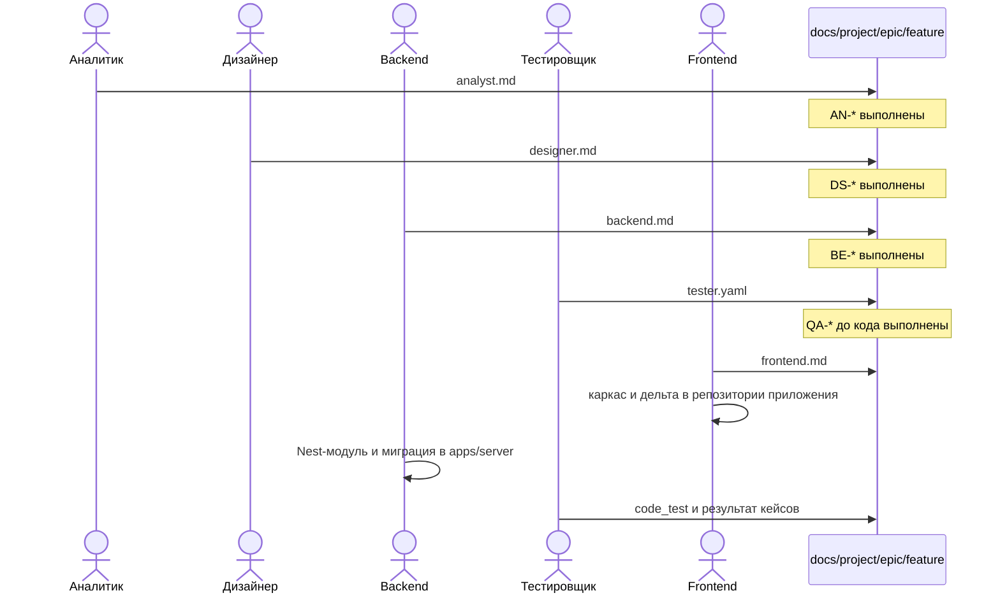
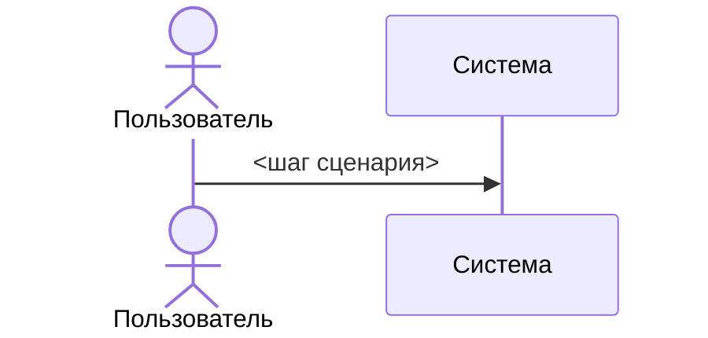
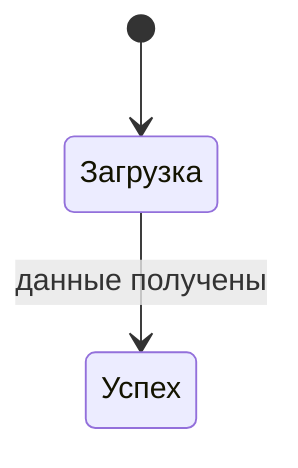
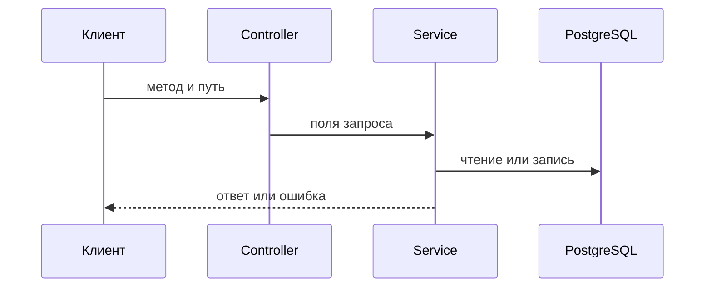
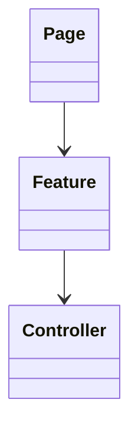

# Репозиторий документации

Этот репозиторий хранит спецификации фич. Код, тесты и сборка SSR остаются в репозитории приложения на **React**, **Nest SSR** и **PostgreSQL** с раскладкой `apps/web` и `apps/server` (см. SPEC плана `react-nest-ssr-postgres`). Роль пишет только свой документ и кладёт его в директорию фичи. Чужой документ возвращается владельцу, а не правится за него.

Идентификаторы `AC-*` выпускает аналитик: это приёмка поведения фичи. Идентификаторы `AN-*`, `DS-*`, `BE-*`, `QA-*`, `FE-*` принимают документ роли: это приёмка артефакта.

## Эпик

Эпик — каталог внутри проекта. Имя — kebab-case. Это не фича и не `settings`. Фича создаётся только внутри уже существующего эпика. Дерево документации начинается с эпиков. `settings` в этом дереве не показывается.

```text
docs/<проект>/
  settings/
  <эпик>/
    <фича>/
```

## Директория фичи

Одна директория — один наблюдаемый результат. Имя директории — `feature-id` в kebab-case. Она лежит в эпике: `docs/<проект>/<эпик>/<фича>/`.

```text
docs/<проект>/<эпик>/<фича>/
  in-progress/
    analyst.md
    designer.md
    backend.md
    tester.yaml
    frontend.md
  ready-to-implement/
  done/
  assets/
```

## Настройки типов документов

У каждого проекта свой каталог `docs/<проект>/settings`. Это не фича и не эпик: селектор проектов и дерево документации его не показывают. В корне настроек лежит `orchestrator.md`; в каждом каталоге типа — `template.*` и `agent.md`. В таблицах оркестратора и агентов путь записывается как `settings/<тип>/` без имени проекта, поэтому текст агента годится в любом проекте. Новая фича читает шаблоны из настроек своего проекта и кладёт в `in-progress` по одному файлу на каждый тип, у которого есть шаблон: имя файла — имя каталога типа плюс расширение шаблона (`analyst/template.md` → `analyst.md`, `tester/template.yaml` → `tester.yaml`). В тексте шаблона плейсхолдер `{{feature}}` при создании фичи заменяется на `feature-id`.

Статус файла — каталог, в котором он лежит. Новая фича кладёт пять файлов в `in-progress`. Смена статуса переносит файл между `in-progress`, `ready-to-implement` и `done`. Статус фичи считается по **всем** файлам в этих трёх каталогах (кроме `assets`), не только по пяти ключевым; отсутствующий ключевой файл считается «в процессе». Порядок: есть хотя бы один файл в `in-progress` или отсутствует ключевой — «В процессе»; иначе есть хотя бы один в `ready-to-implement` — «Готово к реализации»; иначе каждый файл в `done` — «Выполнено». Один и тот же файл в нескольких каталогах берётся по наименее зрелому: `in-progress`, затем `ready-to-implement`, затем `done`. Незакрытый файл в `updates/in-progress` даёт фиче статус «Внесены изменения» и перекрывает три перечисленных статуса; каталог `updates/done` на статус фичи не влияет. Файл изменения создаётся только для спеки, которая уже лежит в `done`.

Визуализатор эти три каталога не показывает; статус на экране — цветной тег «В процессе», «Готово к реализации», «Выполнено» или «Внесены изменения».



Следующий файл появляется после того, как артефакт предыдущей роли принят по своим критериям. С уровня 3 пять файлов, контракт API и код приложения входят в одно изменение и ссылаются на один `feature-id`.

## Аналитик

Файл: `docs/<проект>/<эпик>/<фича>/{in-progress|ready-to-implement|done}/analyst.md`.

Аналитик создаёт директорию фичи и первым добавляет этот файл.

### Вид артефакта

````markdown
# <Название сценария>

feature: <feature-id>
role: analyst

## Контекст
<кто пользуется сценарием и откуда в него попадает>

## Результат
<что можно наблюдать, когда сценарий готов>

## Критерии приёмки
- AC-1. <наблюдаемый факт>
- AC-2. <наблюдаемый факт>

## Вне задачи
- <поведение, которое в эту фичу не входит>

## Контракт
- метод: <GET|POST|...>
- путь: <path>
- поля: <поля, от которых зависит видимый результат>

## Схема



## Задачи
| Номер | Скриншот и ссылка на Pixo | Описание |
|-------|---------------------------|----------|
| | | |
````

Ячейка скриншота — одна ссылка-картинка: `[](https://адрес-макета)`. Клик по превью открывает макет. Если файла нет, в ячейке остаётся `[Pixo](адрес)`.

Для сценария без экрана раздел «Результат» описывает выход операции Nest или сервиса: вход, выход, ошибка. Новые `AC-*` в остальных файлах не появляются.

### Критерии приёмки артефакта

| ID | Критерий |
|----|----------|
| AN-1 | Директория названа `feature-id` и покрывает один наблюдаемый результат. |
| AN-2 | Контекст называет пользователя и точку входа в сценарий. |
| AN-3 | Результат сформулирован как наблюдение, а не как список компонентов. |
| AN-4 | Каждый `AC-*` пронумерован, устойчив и проверяется на экране или по входу и выходу. |
| AN-5 | Раздел «Вне задачи» содержит явные границы. |
| AN-6 | Контракт называет метод, путь и поля, от которых зависит результат. |
| AN-7 | В файле нет слоёв, эталона, команд генерации, матрицы экрана и кейсов. |
| AN-8 | Раздел «Задачи» — таблица из трёх колонок: номер задачи, скриншот и ссылка на дизайн Pixo, описание. |
| AN-9 | В «Схеме» есть `sequenceDiagram`: участники и ветки совпадают с контекстом, результатом и каждым `AC-*`. |

## Дизайнер

Файл: `docs/<проект>/<эпик>/<фича>/{in-progress|ready-to-implement|done}/designer.md`.

Дизайнер добавляет файл после выполнения `AN-*`.

### Вид артефакта

````markdown
# <Название сценария>

feature: <feature-id>
role: designer
depends: analyst.md
ui: screen | none

## Покрытие критериев
| AC | Что пользователь видит или делает |
|----|-----------------------------------|
| AC-1 | |

## Состояния
| Состояние | Когда наступает | Что видит пользователь | Текст | Доступное имя |
|-----------|-----------------|------------------------|-------|---------------|
| Загрузка | | | | |
| Пусто | | | | |
| Ошибка | | | | |
| Нет прав | | | | |
| Валидация | | | | |
| Успех | | | | |

## Действия
| Шаг | Элемент | Клавиатура | Куда уходит фокус |
|-----|---------|------------|-------------------|
| 1 | | | |

## Тексты
| Место | Текст из интерфейса |
|-------|---------------------|
| | |

## Схема


````

При `ui: screen` заполнены все шесть строк состояний. Если состояние в сценарии не наступает, в колонке «Когда наступает» стоит «не наступает» и остальные колонки пустые. При `ui: none` матрица и действия отсутствуют, а входы и выходы остаются в `analyst.md`.

### Критерии приёмки артефакта

| ID | Критерий |
|----|----------|
| DS-1 | В шапке указаны `feature-id` и зависимость от `analyst.md`. |
| DS-2 | Каждый `AC-*`, у которого есть видимое следствие, стоит в таблице покрытия. |
| DS-3 | Для `ui: screen` заполнены шесть состояний, включая явное «не наступает». |
| DS-4 | Тексты записаны дословно, в том виде, в каком их читает пользователь. |
| DS-5 | У каждого интерактивного элемента есть доступное имя, шаг и переход фокуса. |
| DS-6 | Для `ui: none` файл явно фиксирует отсутствие экрана и не дублирует входы и выходы аналитика. |
| DS-7 | Файл не добавляет новых `AC-*` и не назначает слои и поля API. |
| DS-8 | Для `ui: screen` в «Схеме» есть `stateDiagram-v2` по состояниям экрана. Строка «не наступает» в схему не входит. Для `ui: none` в «Схеме» записано «экрана нет», без диаграммы. |

## Backend

Файл: `docs/<проект>/<эпик>/<фича>/{in-progress|ready-to-implement|done}/backend.md`.

Backend добавляет файл после выполнения `DS-*`. Код операции живёт в `apps/server/src/<feature>/`. В документе зафиксирован контракт Nest, сущность TypeORM и миграция PostgreSQL, по которым frontend и тестировщик сверяют поля, статусы и ошибки.

### Вид артефакта

````markdown
# <Название сценария>

feature: <feature-id>
role: backend
depends:
  - analyst.md
  - designer.md

## Операция
- метод: <GET|POST|...>
- путь: <path>

## Запрос
| Поле | Тип | Обязательность | AC |
|------|-----|----------------|----|
| | | | AC-1 |

## Пример запроса
```json
{
  "day": "2026-10-21"
}
```

## Ответ
| Поле | Тип | AC |
|------|-----|----|
| | | AC-1 |

## Пример ответа
```json
[
  {
    "number": "ORD-001",
    "amount": "1000.00",
    "status": "paid"
  }
]
```

## Ошибки
| HTTP | Код | Состояние из designer.md | Когда |
|------|-----|--------------------------|-------|
| | | Ошибка | |

## Правила сервера
- <валидация, пустой результат, повтор того же запроса>

## Эффекты
- <что создаётся, меняется или остаётся прежним в PostgreSQL>

## Данные
| Таблица PostgreSQL | Сущность TypeORM | Миграция |
|--------------------|------------------|----------|
| | | |

Если операция не меняет таблицу, в таблице одна строка «нет» с причиной.

## Источник контракта
- модуль: `apps/server/src/<feature>/`
- controller: <имя>
- DTO запроса и ответа: <имена файлов>
- Swagger: из DTO через `@nestjs/swagger`, если нужен OpenAPI

## Схема


````

Метод и путь совпадают с разделом «Контракт» в `analyst.md`. Схема повторяет те же ветки, что «Ошибки» и пустой результат. Поле из аналитического контракта стоит либо в запросе, либо в ответе.

### Критерии приёмки артефакта

| ID | Критерий |
|----|----------|
| BE-1 | В шапке указаны `feature-id` и зависимости от `analyst.md` и `designer.md`. |
| BE-2 | Метод и путь совпадают с контрактом в `analyst.md`. |
| BE-3 | Каждое поле аналитического контракта есть в запросе или ответе, с типом и обязательностью. |
| BE-4 | Состояния «Ошибка», «Валидация», «Нет прав» и «Пусто», если для них не записано «не наступает», имеют строку в «Ошибках» или явное описание пустого ответа. |
| BE-5 | «Правила сервера» называют валидацию и поведение при пустом результате. |
| BE-6 | «Эффекты» называют, какие строки таблицы PostgreSQL операция сохраняет или изменяет. |
| BE-7 | В «Данных» названы таблица, сущность TypeORM и миграция или явное «нет». В «Источнике контракта» указаны путь к Nest-модулю и DTO. В файле нет слоёв экрана, текстов интерфейса и команд каркаса frontend. |
| BE-8 | Файл не выпускает новых `AC-*`. |
| BE-9 | В «Схеме» есть `sequenceDiagram` вызова: клиент, controller, сервис и PostgreSQL. Ветки совпадают с «Ошибками» и пустым результатом. |

## Тестировщик

Файл: `docs/<проект>/<эпик>/<фича>/{in-progress|ready-to-implement|done}/tester.yaml`.

Тестировщик добавляет файл после выполнения `BE-*`. Исполняемые тесты лежат в репозитории кода. В yaml остаётся сценарий проверки и ссылка на тест.

### Вид артефакта

```yaml
feature: <feature-id>
role: tester
depends:
  - analyst.md
  - designer.md
  - backend.md

cases:
  - id: AC-1
    title: <смысл критерия>
    surface: api
    kind: auto
    state: success
    given: <исходные данные>
    when: <вызов операции из backend.md>
    then: <статус, поля ответа или эффект из backend.md и AC-1>
    code_test: ""

  - id: AC-2
    title: <смысл критерия>
    surface: ui
    kind: manual
    state: empty
    given: <исходные данные>
    when: <шаг на экране>
    then: <текст и состояние из designer.md>
    code_test: ""

checks:
  - name: api
    command: <команда проверок операции>
  - name: unit
    command: <команда тестов по путям фичи>
  - name: ui
    command: <проход состояний из designer.md>
```

`surface: api` проверяет операцию из `backend.md`. `surface: ui` проверяет экран из `designer.md`. `kind: auto` обязателен для контракта Nest API, маппинга DTO, валидации и клиента React. `kind: manual` допустим для прохода экрана по строке состояния. Поле `state` пустое только у кейса без интерфейса. Поле `code_test` до появления теста в репозитории кода пустое; после появления содержит путь к тесту.

### Критерии приёмки артефакта

| ID | Критерий |
|----|----------|
| QA-1 | В шапке указаны `feature-id` и зависимости от `analyst.md`, `designer.md` и `backend.md`. |
| QA-2 | У каждого `AC-*` из `analyst.md` есть хотя бы один кейс с тем же `id`. |
| QA-3 | У кейса заполнены `surface`, `title`, `kind`, `given`, `when`, `then` до начала доменного кода. |
| QA-4 | Для `surface: api` поле `then` называет статус, поля или эффект из `backend.md`. Для `surface: ui` оно называет текст или состояние из `designer.md`. |
| QA-5 | Каждое состояние со значением кроме «не наступает» и каждая строка «Ошибок» из `backend.md` упомянуты хотя бы в одном кейсе. |
| QA-6 | Кейсы контракта Nest API, маппинга DTO, валидации и клиента React имеют `kind: auto`. |
| QA-7 | В `checks` названы проверка операции, команда тестов приложения и, для экрана, проход состояний. |
| QA-8 | После появления теста `code_test` указывает на файл в репозитории кода, а утверждение теста проверяет `then`. |
| QA-9 | В файле нет кейса без `id` из `analyst.md` и нет нового поведения вне этих `id`. |

До кода приняты QA-1…QA-7. QA-8 закрывается вместе с кодом. На уровне 4 пустых заготовок кейса в включённом изменении нет, а команды из `checks` исполняются на изменённых путях.

## Frontend

Файл: `docs/<проект>/<эпик>/<фича>/{in-progress|ready-to-implement|done}/frontend.md`.

Frontend добавляет файл после выполнения QA-1…QA-7. Код пишет в репозитории приложения (`apps/web`, `apps/server/src/ssr`). В документе — page, feature, server module, ssr, эталон каталогов и команды каркаса и сборки SSR.

### Вид артефакта

````markdown
# <Название сценария>

feature: <feature-id>
role: frontend
depends:
  - analyst.md
  - designer.md
  - backend.md
  - tester.yaml

## Слои
- page: `apps/web/src/pages/<Page>/`
- feature: `apps/web/src/features/<feature>/` или «нет» с причиной
- server module: `apps/server/src/<feature>/`
- ssr: `apps/server/src/ssr/<маршрут или файл>`

## Эталон
<имя эталонного набора каталогов из apps/web и apps/server>

## Вызов API
<как страница и фича вызывают controller из backend.md после гидрации: fetch, shared-клиент>

## Поля экрана
| Поле из backend.md | Где читается в интерфейсе |
|--------------------|---------------------------|
| | |

## Трассировка
| AC | Модуль |
|----|--------|
| AC-1 | <путь> |

## Каркас
- <команда Nest CLI или каркаса модуля с параметрами этой фичи>
- <команда миграции TypeORM, если нужна>
- <команда сборки SSR для страницы>

## Дельта
- <что написано вручную поверх каркаса>

## Тексты
Тексты интерфейса взяты из designer.md без перефразирования.

## Схема


````

Команда каркаса называется с параметрами фичи: домен, колонки, поля, эндпоинт из `backend.md`, путь к кейсам. Повторный запуск на уровне 4 воспроизводит каркас и сохраняет дельту.

### Критерии приёмки артефакта

| ID | Критерий |
|----|----------|
| FE-1 | В шапке указаны `feature-id` и зависимости от `analyst.md`, `designer.md`, `backend.md` и `tester.yaml`. |
| FE-2 | Названы пути page, feature, server module и ssr. Для неиспользуемого слоя записано «нет» и причина. |
| FE-3 | Назван эталон каталогов, и новые файлы разложены по page, feature, Nest-модулю и SSR. |
| FE-4 | В «Вызов API» явно описано, как React вызывает controller и DTO из `backend.md` после гидрации. |
| FE-5 | Каждое поле экрана есть в запросе или ответе `backend.md`. |
| FE-6 | Каждый `AC-*` с `surface: ui` стоит в трассировке и указывает на модуль репозитория приложения. |
| FE-7 | В «Каркасе» записаны команды с параметрами этой фичи, и каркас получен этими командами. |
| FE-8 | «Дельта» перечисляет только маппинг, ветки и тексты, которых генератор не создаёт. |
| FE-9 | Тексты экрана совпадают с `designer.md`. Ошибки на экране соответствуют строкам «Ошибок» в `backend.md`. |
| FE-10 | Файл не выпускает новых `AC-*`, не меняет контракт backend и не меняет `then` кейсов. Смена поведения идёт через правку `analyst.md`. |
| FE-11 | В «Схеме» есть `classDiagram`: page, feature и controller из «Слоёв» и «Вызова API». |

## Сводка артефактов

| Роль | Файл | Формат | Когда файл принят |
|------|------|--------|-------------------|
| Аналитик | `analyst.md` | Markdown и sequenceDiagram | Выполнены AN-1…AN-9 |
| Дизайнер | `designer.md` | Markdown с таблицами и stateDiagram | Выполнены DS-1…DS-8 |
| Backend | `backend.md` | Markdown контракта и sequenceDiagram | Выполнены BE-1…BE-9 |
| Тестировщик | `tester.yaml` | YAML кейсов | До кода QA-1…QA-7, вместе с кодом ещё QA-8 |
| Frontend | `frontend.md` | Markdown, команды и classDiagram | Выполнены FE-1…FE-11 |

Каталог `docs/<проект>/<эпик>/<фича>/` принят, когда приняты все пять файлов и каждый `AC-*` прослеживается по цепочке: формулировка в `analyst.md`, видимое следствие в `designer.md`, операция в `backend.md`, кейс в `tester.yaml`, модуль в `frontend.md`.
